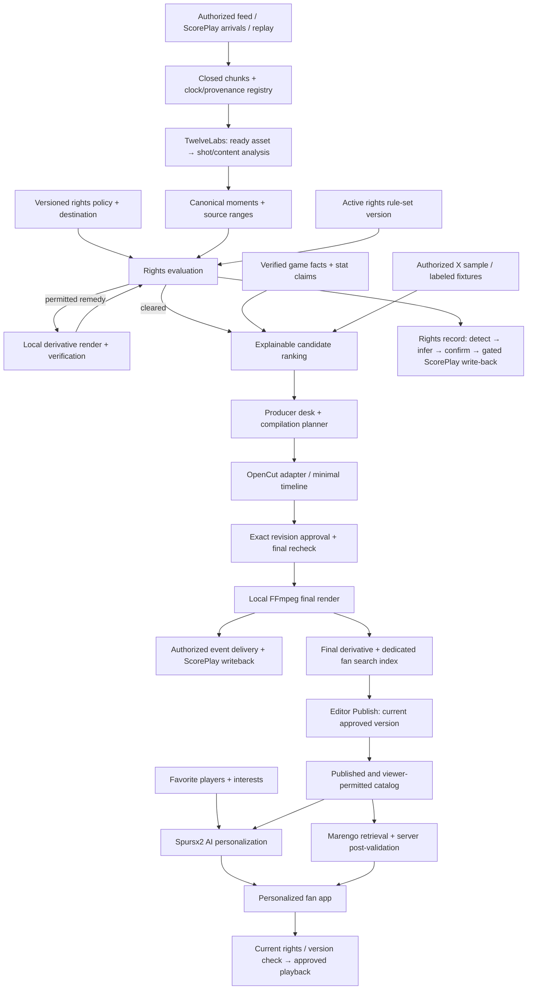

# Spursx2 AI — Editor & Personalized Fan Web App Design

**Spurs² Hackathon · October 22–23, 2026 · revised October 22**  
**Challenge:** Assisted Auto-Production, with rights screening built into the production path  
**Application form:** One responsive browser-based web app: editor dashboard plus an installable fan PWA under `/fan`. Fans can add it to their home screen or use it directly in the browser; no native mobile app or app-store release is required.
**Primary user:** Club producer / social video editor  
**Fan-facing output:** Personalized clip feed, favorite players, and natural-language search  
**Status:** Implementation plan. The HTML brief is an explanatory prototype, not the completed product.

> **Product promise:** Editors validate the moments. Fans get the moments they care about—and can ask for the clip they want.

The production promise stays intact: put the five most useful destination-cleared options in front of the editor, with explanations, sourced story hooks, and an editable rough cut.

The product has **two connected surfaces**: an editor-first matchday production desk and a **personalized fan app**. The desk receives footage, finds moments, evaluates rights, creates permitted derivatives, ranks options, and helps an editor assemble clips and montages. The editor validates and explicitly publishes a prepared version to the fan catalog. Fans follow favorite players, select interests, get different feeds from that approved catalog, and ask for clips in natural language. The editor approves instead of searching through a match; the fan discovers the published moments that matter to them.

The **personalized fan frontend replaces the stadium viewer**. Ticketing is outside this scope. Location remains a pitch/court zone or camera filter inside the editor, while fan preferences center on players and interests. The previous spatial design is [archived](docs/archive/hypeseat-spatial-design-2026-10-22.md); its verified API work is retained in [the evidence report](docs/research/twelvelabs-live-evidence-2026-10-22.md).

## 1. Scope and evidence

### What is established

| Evidence | Status and implication |
|---|---|
| Organizer builder brief, now supplied | Teams should produce audience-specific outputs, use outside signals, show rejected candidates, preserve human approval, and write findings back to ScorePlay. We choose Challenge 1; compliance enables that workflow rather than adding a separate rights-manager product. |
| ScorePlay / TwelveLabs onboarding decks | ScorePlay is the media system of record; editing compute runs locally for this event. The supplied football fixture is an away match at Old Trafford. Teams have different platform IDs. |
| Authenticated TwelveLabs audit | One visible `premiere-league` index with **58/58 ready videos**; the asset endpoint reports **476 assets**. Two searches and one timed-analysis task succeeded. No basketball index was visible. |
| Actual source join | All 58 indexed videos carry `user_metadata.scoreplay_id`, plus origin event/rendition/type. Search `video_id` equals indexed-asset `_id`; Pegasus uses the underlying `asset_id`. Origin IDs still require reconciliation with the team's ScorePlay instance. |
| Measured analysis | One **24-second** source window produced four shot classifications in **58 seconds**. This is one measurement, not an instant-processing promise or a live-feed benchmark. |
| Current repository | A producer queue, pipeline worker, FFmpeg renderer, schemas, illustrative content rules, and publish adapters already exist. Their presence is not proof that they satisfy the new plan. Reuse and extend them. |
| Missing external inputs | No live broadcast endpoint, current ScorePlay credential, authorized club policy pack, complete historical stats dataset, or X read credential was supplied for this design revision. Real integrations remain adapter work; fixture/replay inputs must be labeled. |

**Event terms:** the builder brief limits media to event use and forbids downloading, posting, or sharing outside the event. The ScorePlay onboarding deck explicitly describes authorized local proxy processing. Keep all working media and derivatives in organizer-permitted local/private environments, clarify any retention conflict with staff, and keep external publication disabled for club content. Tags/logs do not grant broader media rights. For this event the worker, renders and render storage run on team laptops only: no cloud worker or cloud object storage for club media, and local copies are purged with a logged file count afterwards.

### Delivery tiers

- **P0:** Replay-as-live or arriving-asset path; discovery; rights gate and one real audio cleanup; explainable queue and sourced/fixture stat hook; three-clip compilation and editor trim/reorder; approved render; **editor Publish → event-only fan catalog → two favorite/interest profiles with different feeds → natural-language Marengo search over approved derivatives**; withdrawal and playback checks; ScorePlay writeback evidence.
- **P1:** Authorized live feed, X reads, richer historical hooks, fuller OpenCut editing, alternate angles/formats, persistent authenticated fan profiles, saved clips/feedback, optional beta entity search, and second-sport proof after locating its index.
- **P2:** Automated tracked visual redaction, broad historical record discovery, many live camera feeds, advanced OpenCut effects and server-render parity, distribution outside the hackathon environment.

OpenCut integration has a bounded P0 spike; its fuller editor is a desired product capability, with the existing renderer and a simple timeline preserving the core demo if that spike fails.

## 2. Editor journey and dashboard

1. Choose match, target audience, destination profile, and output format. A profile includes **platform, territory set, owned/paid/partner use, language, intended release time**, and the club policy version.
2. The desk shows feed health, available footage, analysis backlog, source age, and processing mode: **LIVE / REPLAY / FIXTURE**. Never display replay as a live broadcast.
3. New candidates enter an inspection lane. Only clips cleared for the selected context enter **Ready to use**. Others remain accessible to authorized reviewers under **Cleaning / Needs review / Blocked / Rejected**, with reasons.
4. Each ready card answers **Why now? Why this clip? Why allowed here? What evidence supports the hook?** It shows duration, match time, source range, camera, zone, rank breakdown, freshness, and source links.
5. Editors filter by player, play type, pitch/court zone, camera view, recency, audience, and theme. A 2D zone map is an optional shortcut alongside accessible filters. Unknown location remains selectable as unknown.
6. Open a clip in the editor, inspect the original versus cleaned output, trim, mute, replace audio, add approved graphics/captions, or place it in a compilation. Every material edit creates a new draft revision and invalidates earlier approval.
7. Approve the exact draft. The backend rechecks rights, evidence, policy version, and dependencies, then renders and prepares/indexes the approved final derivative. **Publish to fan app** commits its exact publication version, featured-player tags, interests, visibility window, and allowed audience; it is distinct from saving or approving. Demo release stays inside the event.
8. Unpublish/withdraw or prepare a replacement version without deleting the source. A replacement becomes current only when it is ready and approved; withdrawn/expired versions disappear from feed, search, details, and new playback grants.

```text
┌ Match / feed health / LIVE or REPLAY ─ Destination: Instagram · US · owned ┐
│ Ready (5) | Cleaning | Needs review | Blocked | Rejected | Compilations   │
├ Ranked candidates ───┬ Preview / OpenCut editor ─────┬ Justification ────┤
│ 01 · last-play moment│ Original ↔ permitted variant │ WHY THIS MOMENT   │
│ rank 87 · 12s       │ playback / trim / crop        │ video + game + X  │
│ source + rights chip│                               │ FACT CHECK        │
│ 02 · crowd response │                               │ source / coverage │
│ 03 · bench reaction │                               │ RIGHTS            │
│ player / zone filter│                               │ rule / remedy     │
├─────────────────────┴───────────────────────────────┴───────────────────┤
│ Compilation: Hook → build-up → payoff → reaction → end card             │
│ [Recommend montage] [Save draft] [Review & render]  export status        │
└────────────────────────────────────────────────────────────────────────┘
```

### Admin UX quality bar — P0

The admin desk must feel like a polished editorial tool: clean typography, generous spacing, restrained color, a dominant media preview and one clear primary action for the current step. Keep the three-pane workflow, but progressively disclose evidence, technical status and advanced controls. Deep diagnostics belong in drawers; essential rights, identity and freshness states stay visible.

- A persistent **Act now** rail surfaces a small set of actionable hot clips with thumbnail, player/play, why now, signal age, momentum sparkline, evidence coverage and readiness. Hot but blocked/unresolved moments sit in a separate needs-attention lane with the next step; they never appear ready to publish.
- Selecting a card updates the preview and inspector in place. Preserve filters, scroll position, selection, playback position and unsaved edits. Incoming signals must not steal focus or reshuffle the card being edited; show a “new hot moments” indicator and let the editor apply the refreshed order.
- Support keyboard navigation, visible shortcuts and a command palette for find, next/previous clip, preview, claim, snooze, dismiss and open channel packaging. Shortcuts must not fire while typing; publication remains explicit and revision-bound.
- Use autosaved drafts with saving/saved/error feedback, recoverable edits, optimistic reversible actions with rollback, and undo for queue dismissal. Approval/publication confirms server success; no optimistic success for a release or rights decision.
- Channel packaging uses consistent destination tabs with immediate aspect/safe-zone previews, editable trims/crops/copy, batch render and per-output progress. Avoid repetitive dialogs and show actionable inline validation.
- Use skeletons, stable layouts, subtle motion and reduced-motion support. Provide accessible contrast, focus states and keyboard equivalents to drag/reorder. Empty, loading, disconnected, held and failed states explain the next useful action.
- One editor can claim a hot moment; other editors see ownership and current status. Snooze/dismiss asks for a lightweight reason; activity and version-conflict handling prevent duplicate effort and overwritten edits.

Quality targets for verification, not current performance claims: visible acknowledgement within 100ms for local interactions; no focus/selection loss during refresh; one click from a hot alert to playable review when its draft is ready; keyboard completion of the core workflow. Test the actual media load separately from local UI feedback. Visual QA must cover desktop and smaller laptop screens plus all loading/error states.

### Automatic ScorePlay write-back and channel packaging

Approval of an exact clip revision automatically queues a source timeline log in ScorePlay with timecodes, evidence, tags and the approval reference. Once final renditions are ready, the worker automatically uploads them into the approved output collection and attaches source/revision/channel metadata. No per-clip sync action is required. Persist pending/synced/held/failed state and provider IDs; use idempotency keys, retry/backoff and reconciliation to avoid duplicate logs or uploads. Existing taxonomy/workspace sign-off holds live writes until configured, then queued eligible writes resume after current-state checks. Source logs, rendition uploads and rights metadata (§4) share **one write-back module, one gate and one allow-list**; editorial approval queues the source log, while `rights:` tags are written only from a confirmed rights record, never inferred from the approval itself.

The publisher/editor takes an approved clip into a channel packaging workspace and selects all relevant social destinations plus the fan app. Offer Instagram Reels/Stories/Feed, TikTok, YouTube Shorts/Highlights, X video/photo and an explicit owned fan-web profile where appropriate to the source. Suggest and preview a separate cut, duration, aspect/resolution, crop, caption/safe-zone placement, audio, poster and copy for each destination. Reuse `pipeline/channel-profiles.json` and extend it for the app rendition.

Each variant keeps its source lineage, destination context, recipe and revision hash. Material changes invalidate that variant's approval; the approved source does not grant blanket approval to a new cut or destination. Batch render approved eligible variants as independent jobs and validate actual output dimensions, duration and media constraints. Show per-destination progress and allow failed variants to retry independently. Automatically sync completed renditions to ScorePlay. Fan publication commits only the prepared app rendition and its dedicated search mapping. Preparing social assets does not itself post them externally; event restrictions still govern release.

### Clip metadata is required for personalization

Every clip must automatically acquire a structured, versioned metadata record before publication. Pull available source metadata from ScorePlay, reconcile canonical player/team IDs, and enrich the exact clip time range with TwelveLabs analysis. Source-level roster tags are candidates, not proof that every tagged player appears in an excerpt.

Required fields include source/provider IDs and source ranges; club, opponent, match, competition and sport; clip-level featured players with roles where supported (scorer, assist, featured subject); play/event type; interest tags such as goals, saves, skills, crowd energy and behind-the-scenes; language, duration and destination variant; and publication/rights context. Store evidence references, provider, confidence, verification state and metadata version for inferred fields. Optional match-clock, score and statistical hooks require supporting data; never fill missing facts by guessing.

Enrichment runs automatically. Confirm supported source facts, surface uncertain identities or conflicting evidence for editor correction, and record unknown/no-player explicitly. A clip can be reviewed and published without an identifiable player, but unknown or unverified identities must not match a favorite-player filter or produce a player-specific reason chip. Approval commits the metadata for that exact clip revision.

Trims, crops, substitutions and compilations must recompute or revalidate affected tags against the actual visible final output. Preserve canonical metadata lineage across social/app renditions, while allowing different featured-player sets when the cut or crop changes who appears. Compilation tags derive from verified entries with chapter/time mappings. Corrections version the metadata and invalidate affected feed/search caches and index metadata; identity or factual changes require renewed editorial approval before the replacement becomes current.

Fan preferences use the same canonical player, club and interest IDs. Feed ranking, favorite-player pages, search filters and explanation chips read the reviewed metadata on the current published app rendition. Test that two profiles get different ordering, a tagged player outside the final cut cannot trigger a match, and corrected/unknown identities cannot leave stale personalized results.

### Fan PWA requirements (P0)

Deliver `/fan` as an installable Progressive Web App in the existing Next app. Use the Spursx2 AI name, app icons including a maskable icon, theme/background colors, a `/fan/` start URL and scope, and standalone display. Provide install guidance appropriate to the browser and an in-browser experience when installation is unavailable or declined. Keep the editor/admin outside the fan service-worker scope.

Build mobile-first navigation, touch targets, safe-area layouts, responsive media and deep links to published clips/player pages. The installed app and normal browser must use the same preference and publication services. Keep installation optional; a shared link must work without installing.

Cache only the versioned static app shell and a neutral offline screen. Do not cache club video/audio, range responses, signed proxy/media URLs, thumbnails, personalized feeds/search results, clip details or publication/rights responses for offline use. The service worker must bypass protected/dynamic content; current server eligibility remains required for discovery and new playback. Offline mode explains that connection is required to load clips, rather than serving stale or withdrawn content. Reconnect refreshes publication state.

Use HTTPS for the deployed PWA and test on supported Android and iOS browsers plus installed standalone mode; local development follows browser secure-context rules. Offer a clear update-available/reload flow without interrupting active playback or discarding preferences, and clean up obsolete static caches on activation. Push notifications and offline media downloads are deferred; they are not prerequisites for this PWA.

Acceptance: manifest/icons/start URL validate; home-screen launch opens `/fan/` in standalone mode where supported; direct clip links work in browser and installed contexts; offline launch shows the cached shell/fallback without protected content; reconnection and service-worker upgrades work; withdrawal still blocks discovery and new playback in installed mode.

### Personalized fan journey

- Choose a club, favorite players, and interests, with a skippable onboarding flow and an editable preference screen.
- Open **For You**: the app ranks only editor-published, currently permitted clips/compilations for that fan. Explain cards with “Because you follow [player]” or “You chose crowd energy.” Fan relevance is separate from the producer's hype score.
- Browse favorite-player pages; tags are verified at clip level, not copied blindly from whole-match player metadata.
- Search **“Give me a clip of [player] scoring”**, “Show bench reactions,” or another supported natural-language request. **Marengo 3.0 retrieves relevant published clip ranges**; Pegasus handles analysis, while our app handles preference ranking.
- Play the approved derivative at a relevant matching offset, with approved captions and source context. Search never generates or publishes a new unreviewed cut.
- Handle no favorites, no matches, unavailable regions, withdrawn content, and provider fallback honestly. An explicit query about a different player is not silently constrained to the fan's favorites.

**Implementation handoff:** [docs/fan-app-and-search.md](docs/fan-app-and-search.md) defines onboarding, feed weights, verified player identity, safe Marengo scope, publication lifecycle, routes, data contracts, and tests. This is the required fan frontend, not a stadium feature.

**Separate four explanations:** editorial ranking, factual/statistical support, rights eligibility, and processing/delivery provenance. A high ranking never compensates for an unverified claim or a rights block. Missing evidence is shown explicitly rather than narrated away.

## 3. Continuous ingest and clip generation

### Product input modes

| Mode | Implementation | Truth label |
|---|---|---|
| Existing indexed archive | Query the organizer's index and resolve existing ScorePlay media. | Indexed archive; real source-backed AI results |
| Replay-as-live, P0 | Advance a replay clock over the supplied match. Release only footage available at that virtual instant. Cached real results are allowed, with cache/replay labeling and a `visibleAt` cutoff. | Replay; analysis cached or live per card |
| Arriving assets | ScorePlay webhook or bounded polling detects a completed new asset; register the asset/version and submit bounded analysis. Deduplicate webhook deliveries. | Arriving media; measure detection and processing delay |
| Authorized live feed, P1 | An ingest worker captures a permitted broadcast/ISO source into completed chunks and retains a rolling event-local buffer. Confirm the actual feed protocol/access first. | Live only after source connectivity is demonstrated |

**Do not send an endless live URL directly to Pegasus.** Its documented URL input accepts files/VOD HLS and rejects live streams. Close a chunk, then upload/reuse a ready asset and analyze it. Text-response streaming is not live video ingestion. [TwelveLabs async SDK input contract](https://docs.twelvelabs.io/v1.3/sdk-reference/node-js/analyze-videos/async-analysis).

### Proposed hot path

1. Capture closed **20–30-second chunks** with a short overlap; persist feed/segment sequence, discontinuity ID, source start/end, wall-clock anchors, and checksum. These sizes are application starting points, not vendor requirements.
2. Use game-event triggers when available and cheap video/audio cues to shortlist windows. A video-only sweep must still discover bench/crowd moments absent from a stats feed. Never require every moment to trend on X.
3. Upload a new chunk only when needed and authorized; await asset readiness. Analyze that asset directly without waiting for Marengo indexing. Index asynchronously for subsequent semantic search.
4. Pegasus supplies shot boundaries, visible/audible content, event descriptions, uncertain identities, coarse zone and camera cues. Normalize them into candidates; do not invent calibrated confidence scores.
5. Merge duplicate views/replays into a canonical play/event with separate camera-source references. Keep distinct reactions as related moments. Do not dedupe solely by filename or overlapping timestamps across different feeds.
6. Evaluate processing and distribution permissions. If remediation is permitted, create a derivative, inspect the result, and reevaluate the destination decision. Only eligible candidates enter the main recommendation set.
7. Enrich eligible moments with approved game facts and sampled social clusters, rank them for the selected audience, and offer an editable draft.

**Clock contract:** maintain `sourceSec`, `chunkLocalSec`, wall-clock time, and period/game clock separately. Chunk-local output maps as `sourceSec = chunk.sourceStartSec + chunkLocalSec`. Handle halftime, basketball stopped clocks, overtime, reconnects, and PTS resets with explicit anchors; never equate game minute with video minute.

**Response-mode distinction:** the October 22 async timed-metadata test retained absolute source offsets; the repository's earlier general JSON-schema probe reports window-relative custom moment times. Store `timestampBasis` on every analysis result and use a mode-specific adapter. Do not globally add—or globally omit—the window offset.

**Operational constraints:** one analysis task at a time initially; cap candidate windows and cache by source version/range/model/schema. Use persistent task IDs, `custom_id`, bounded polling/backoff, and freshness indicators. Track ingest → analysis → rights → ready → render durations separately. The 58-second sample requires an asynchronous UI; any faster target is unproven.

## 4. Rights screening and compliance cleaning

### Policy facts and decision context

Pegasus detects **content facts**; it does not grant permission. A policy pack approved by club/rights staff supplies the rules. Convert policy text into draft structured rules with the source document, clause, effective dates, owner, and version; a person activates those rules. Existing `pipeline/rules/content-rules.json` is explicitly illustrative and must not be presented as Tottenham, Spurs, NBA, or Premier League policy.

Evaluate each exact source range/derivative against:

```typescript
type DistributionContext = {
  orgId: string;
  platform: string;
  territories: string[];
  use: "owned_social" | "owned_fan_web" | "paid" | "partner" | "internal_preview";
  language: string;
  releaseAt: string; // UTC; display the selected destination timezone too
  policyVersion: string;
};
type RightsStatus = "cleared" | "needs_remediation" | "needs_review" | "blocked" | "expired";
```

A decision contains `ruleId`, policy/clause reference, matched evidence/time ranges, context, rationale, allowed actions, required remedies, validity interval, `evaluatedAt`, and source/derivative fingerprints. Unknown rights do **not** become cleared because no rule happened to match. Internal analysis/view permission and fan distribution permission are separate. Owned-social permission does not imply owned-web permission. Feed, search, poster/detail responses, and playback must enforce the current viewer context for the exact publication version.

### Permitted transformations, not blanket clearance

| Issue, if actually restricted by the supplied policy | Proposed action | What still has to pass |
|---|---|---|
| Unlicensed music in an otherwise permitted clip | Remove the full affected audio track/range; optionally add club-cleared audio. Preserve crowd audio only if separately available/verified. | Probe rendered tracks; reevaluate remaining visual, speech, broadcast, and distribution rights. Audio-risk detection alone is not music identification or ownership proof. |
| Removable restricted shot | Cut that shot, repair narrative continuity, record excluded range. | Reevaluate the resulting range and captions; trimming cannot satisfy a minimum embargo. |
| Restricted face/logo with an approved redaction remedy | Offer tracked blur/crop only if permitted and verified across all affected frames. Otherwise hold or choose another shot. | The action remains visible, masking persists after transitions/crops, and the rule explicitly accepts redaction. P0 does not claim reliable automatic tracked redaction. |
| Embargo, expired right, disallowed territory/platform, prohibited commercial use | Hold, schedule within a valid window, choose an allowed profile, or exclude. | Muting, blurring, cropping, subtitles, or captions cannot erase a distribution restriction. |
| Dubbed/subtitled/synthetic-commentary variant | New derivative/version; reevaluate speech, voice, likeness, text, music, and destination permissions. | Clearance is specific to that variant; it does not inherit automatically. |

### Decision lifecycle and enforcement

```text
candidate → evaluate → cleared ───────────────────────────→ eligible queue
                   ├ needs_remediation → render → verify → reevaluate
                   ├ needs_review → authorized rights review
                   └ blocked / expired → explanation + permitted alternatives
```

- Default queue = only `cleared` for the currently selected context and valid output revision. Restriction changes remove stale cards from that queue.
- Show excluded/held clips with the precise reason, not a permanently invisible discard bin. Protect access to restricted previews; merely viewing or analyzing may itself require permission.
- An editor cannot click through an unresolved block. An authorized rights reviewer can correct facts or attach an explicit exception with issuer, scope, expiry, and audit record; this generates a new decision.
- Recheck at **recommendation, timeline import, approval, render start, and final asset delivery**. Check every video, still, title, audio bed, end card, language variant, and excerpt actually in the final cut.
- Bind approval and release permission to the edit-manifest hash, dependencies, source versions, context, and policy version. A trim expansion, added clip, restored audio, changed headline, or new destination invalidates approval.
- The server authorizes render jobs and signed final-asset access. Hiding a browser export button or writing a ScorePlay tag is not access enforcement. Existing preview/download routes and all OpenCut export entry points must be audited.
- If a source decision is revoked/expired, invalidate dependent recommendations, fan publications/search eligibility, projects, and new exports; revoke links under our control. Do not promise to recall downloaded copies or externally published media automatically.
- Write the confirmed verdict, source timecoded evidence, selected/rejected ranges, remediation lineage, and output reference back to ScorePlay through the gated write-back path below, after taxonomy agreement. Record `pending / synced / held / failed`; reconcile ambiguous retries.

### Rights metadata stage: detect, infer, write back

Most source media carry little or no rights metadata. This rules-engine stage runs per ScorePlay media item before the destination decision and has three steps. ScorePlay metadata is optional input; the media content (Pegasus facts) is the primary source for content fields.

1. **Detect.** Read the item (`GET /media/{id}` with tags) and score it against the required-field checklist. Status is `complete`, `incomplete` (list the missing fields) or `absent`. An empty or `0` field is *missing*, never permission.
2. **Infer.** For missing content fields only, derive values from cached Pegasus facts for the analysed range. Contract fields cannot be inferred from pixels; they stay `unknown` until ScorePlay or an authorized reviewer supplies them.
3. **Write back.** After a person confirms the record, write it to ScorePlay through the single gated write-back path.

| # | Required field | Kind | Source if missing | Complete when |
|---|---|---|---|---|
| F1 | Brands/logos (name, category, location, time range) | content | Pegasus `detectedSponsors` | A list or an explicit "none seen" for the analysed range |
| F2 | On-screen text (odds/promo/other, time range) | content | Pegasus on-screen text | As F1 |
| F3 | Music/audio (stadium or recorded music, commentary) | content | Pegasus `audioRisks` | As F1 |
| F4 | Identifiable players | content | Pegasus `identifiablePeople` + roster | Players resolved to canonical IDs, or "none identifiable"; uncertain names stay uncertain |
| F5 | Crowd faces / close-ups | content | Pegasus `crowdPrivacy` | Both booleans present |
| F6 | Competition/broadcast markings | content | Pegasus `competitionMarkings` | As F1 |
| F7 | Access window (`accessible_from` / `accessible_until`) | contract | none: ScorePlay or reviewer | Non-zero value, or reviewer-confirmed "no window restriction" |
| F8 | Usage / custom terms | contract | none: ScorePlay or reviewer | Value present, or reviewer-confirmed |
| F9 | Partner DRM windows (`external_accounts_drms`) | contract | none: ScorePlay or reviewer | Read succeeded; list or confirmed empty |
| F10 | Sponsor and player tags on the source | contract | none (read only) | Read succeeded |

**Precedence, field by field:** existing ScorePlay or human metadata beats inferred metadata. Inferred values fill gaps only and never overwrite an existing value. When existing and inferred values disagree (for example a sponsor tag Pegasus did not see, or a brand Pegasus saw that the tags omit), keep the existing value, record the conflict, and set the record to `needs_review`. Every field stores `provenance` (`existing_scoreplay`, `existing_human`, `inferred`, `inferred_confirmed`, `unknown`), evidence references with source time ranges, a categorical confidence (`observed`, `uncertain`; Pegasus returns no calibrated score, so no numbers are invented), and the confirming actor.

**Unknown never clears.** Any required field still `unknown` or in conflict at confirmation time makes the written verdict `needs_review`, never `cleared`. An inferred-only record can be written as `cleared` only after an authorized reviewer confirms it. A desk decision that clears one destination is not a ScorePlay `rights: cleared` tag. An asset-wide tag reflects only what was analysed: if the analysed windows do not cover the whole asset, the record also carries `rights: partial coverage`. Seeded or fixture facts never produce live writes.

**Per-item rights record (stored locally, summarised in ScorePlay):** media ID, analysed ranges, completeness status, fields with provenance/evidence/confidence, verdict state (`cleared`, `needs_remediation`, `needs_review`, `blocked`, `expired`), rule-set version, engine version, run ID, facts hash, source (`live`, `cache`, `fixture`, `seeded`), confirmer and confirmation time, and write-back state.

**What is written to ScorePlay, and nothing else:**

| Target | Endpoint | Use | Status |
|---|---|---|---|
| Rights state + provenance tags on the source media | `POST`/`DELETE /media/{id}/tags` with `tag_option_ids` | One state tag (`rights: cleared` / `needs remediation` / `needs review` / `blocked` / `expired`) plus `rights: inferred` and, when applicable, `rights: partial coverage` | Endpoint verified in the ScorePlay spec. Tag options are created once at setup (`POST /tag/options`, search first: no uniqueness rule) under one `Spursx2 AI: rights` tag filter |
| Timecoded audit entry | `POST /video/logs` (`company_id` from the media, `start_offset`/`end_offset` in seconds) | One line per confirmed record: state, detected elements with times, provenance, rule-set version, run ID, confirmer, `[clout:rights-<mediaId>-<hash>]` marker; allow-listed `raw_tags` only, because `raw_tags` auto-create tags | Verified in the spec; existing `writeMomentAsVideoLog`/`findOurLog` pattern |
| `PUT /media/{id}/details` | — | **Not used:** it overwrites `description` | Verified overwrite |
| `accessible_from` / `accessible_until` | — | **Not written:** asset-wide, and expiry hides media for users. Read only | Verified writable, deliberately excluded |
| Custom fields | — | No such endpoint | Verified absent |

**Write rules:**
- **Gate:** writes happen after human confirmation of the rights record. Writing inferred records before confirmation is an open decision; the default is no.
- **Allow-list:** one list holds every tag and field we may write (the TAXONOMY groups plus the `rights:` options above); anything else is rejected before send.
- **Idempotency:** the write key is `mediaId + rule-set version + facts hash + verdict`. Read current tags, then delete only `rights:` tags our own records wrote (stored tag IDs) and add the new ones. A `rights:` tag we did not write is existing human metadata: it wins, and a different inferred value becomes a conflict. Logs are skipped when our marker already exists. Retries and restarts never duplicate a log or tag. Tag writes fire `media.update`; ignore it when our stored record is unchanged.
- **Dry-run and kill switch:** dry-run (the current held mode) records the exact payload that would be sent and labels it DRY RUN. A kill switch (an admin toggle stored in the database, plus an env override) is checked immediately before every send, including retries; when on, work moves to `held`.

### Configurable rights rules

Rules are data, not code. An admin **Rights rules** screen lists every rule with its label, `illustrative` or `verified` tag, scope, severity, effective dates and citation. Admins can enable or disable a rule, edit its parameters, territory and platform scope and its outcome (`block`, `review`, `remediate`), and add a new rule (for example a territory's gambling-advertising law, an AI-content disclosure duty or a music-licensing rule) without a code change. Saving creates a draft; **Validate** runs the schema and lint; **Preview** evaluates the draft against sample media using cached facts and shows which verdicts would change; **Activate** publishes a new immutable rule-set version.

```typescript
type RuleDef = {
  id: string; label: string; status: "illustrative" | "verified";
  citation?: { title: string; url?: string; clause?: string };
  enabled: boolean;
  scope: { territories: string[] | "*"; platforms: string[] | "*"; uses: string[] | "*" };
  when: Condition;                       // over rights-record fields, Pegasus facts and context
  outcome: "blocked" | "needs_review" | "needs_remediation" | "expired";
  remedy?: "mute_audio" | "trim" | "hold_until";
  effectiveFrom?: string; effectiveTo?: string; // UTC
  params?: Record<string, string | number | boolean | string[]>;
};
type Condition =
  | { all: Condition[] } | { any: Condition[] } | { not: Condition }
  | { fact: string; op: "eq" | "neq" | "in" | "contains" | "exists" | "missing" | "lt" | "gt" | "before" | "after"; value?: unknown };
```

The condition language is that small JSON tree, evaluated by a pure interpreter; there is no `eval` and no user code. `fact` paths come from a fixed registry (for example `brands[].category`, `onScreenText[].kind`, `audio.music`, `players[].rosterStatus`, `media.accessibleUntil`, `context.territory`, `content.aiGenerated`). The lint rejects unknown paths, operator/type mismatches, empty scopes, `effectiveTo` before `effectiveFrom`, and `verified` without a citation.

Storage: `rights_rule` (current draft rows, JSON definition), `rights_rule_set_version` (immutable: version number, rules JSON snapshot, content hash, activated by/at, note) and `rights_rule_audit` (who, when, action, rule ID, JSON diff). The six existing rules (access window, partner windows, brand category by territory, partner conflict, departed player, music) are seeded from `pipeline/rules/` as version 1, labelled `illustrative`.

Engine contract: the evaluator is deterministic. It loads the **active** rule-set version at evaluation time, applies only rules whose scope and effective dates match the context, and pins `ruleSetVersion` on every decision and rights record. Deny beats allow (precedence `expired > blocked > needs_review > needs_remediation > cleared`), and a rule whose fact is `unknown` yields `needs_review`, never `cleared`. Activating a version queues re-evaluation of affected current decisions from cached facts only: no new Pegasus calls. A decision whose state changes supersedes the old one and follows the existing withdrawal and write-back rules. The LLM may explain a verdict; it never creates or changes one.

### Gaps in the existing code to fix

`shared/compliance.ts` currently reports territory restrictions as reasons without evaluating a requested territory. `web/lib/actions.ts` blocks approval only for `blocked`; `unknown` and `restricted` are not a sufficient destination-clearance gate. The render worker also needs variant/context-aware checks and a revision binding. `shared/storage.ts` can still upload renders to S3 and `/renders` can redirect to a presigned bucket URL; both must be local-only. `shared/clients/scoreplay-rights.ts` emits restrictions only for fields that are present, so an item with no rights metadata produces no restriction and `evaluate()` returns `cleared`; there is no completeness check. `shared/content-rules.ts` already turns Pegasus facts into restrictions, but its rules are a fixed JSON file loaded at import, with no versioning, scope dates or per-field provenance. The final-render write-back sends `raw_tags: ["clout-approved", …]`, which is outside the taxonomy. Extend the existing modules and tests; do not declare the new compliance behavior already implemented.

## 5. Hype and relevance ranking

Run ranking **after** destination eligibility. Keep all considered candidates and their selection/rejection reasons. Maintain separate priorities for rapid individual posts and a balanced post-game story.

### Proposed transparent starting score

For each eligible candidate, normalize each available component to 0–1:

`score = 100 × weighted mean(event impact .30, audience fit .20, video intensity .15, sampled social momentum .15, verified stat hook .10, recency .10) − duplicate/fatigue penalties`

These are tunable editorial weights, not probabilities or validated engagement predictors. If an input is missing, omit its weight and renormalize the available weights; display **evidence coverage** and missing channels. Do not fabricate a social score or penalize an otherwise strong clip because X is disconnected. Do not silently merge simulated inputs with observed ones.

- **Event impact:** verified game context, game state, late/decisive action, or editor-confirmed significance. A big play may be an opponent play; `teamRelation` must be explicit.
- **Audience fit:** player/community, casual fan, international audience, superfans, sponsor audience. Sponsor outputs pass their own usage/category rules.
- **Video intensity:** observable bench/crowd reaction, action, visual clarity, and usable audio; model interpretations are labeled and reviewable.
- **Social momentum:** local sampled growth, distinct authors, freshness, and event/entity match; one prolific account cannot count as many independent fans.
- **Stat hook:** only a verified claim with sufficient coverage boosts the rank. An interesting but unverified lead stays in the investigation panel.
- **Recency/diversity:** favor current useful moments, group alternate angles, cap repeated players/themes, and allow the editor to pin an overlooked candidate.

A card's reason might read: **“Late equalizer candidate; crowd reaction detected; 3 independent evidence types; strongest for casual fans.”** Each clause expands to its evidence. Numbers in UI fixtures are marked **illustrative**, not actual observed fan response or sports facts.

### Outside signals and the fast-response loop

Build an authorized signal ingestion layer for **X match/player conversation**, licensed/organizer match-event or stats feeds, permitted club/league news or RSS updates, and first-party app activity once real usage exists. These are planned adapters, not connected feeds. Start with one authorized live source plus labeled replay fixtures; expose unavailable providers without invented metrics. Do not add a dependency on scraping private pages or unlicensed media.

Normalize each signal with provider/event ID, source link, event/observation times, query/sample coverage, canonical match/team/player/play IDs, metric snapshots, confidence and live/replay/fixture mode. Reconcile entities and time windows to the candidate ledger and exact footage; ambiguous or wrong-match signals remain unmatched. A signal with no clip creates a scoped discovery request, not a claim that an asset is ready.

Compute explainable **urgency** separately from editorial quality and fan relevance: sampled acceleration versus a comparable baseline, independent observed authors, event significance, freshness and evidence confidence. Record raw counts, window/baseline and missing coverage. A high score means an editorial opportunity in our observed sample, not predicted virality. Bot-like repetition, duplicate reposts, stale news and corrected match events reduce or invalidate support. Missing providers do not supply zero or imaginary popularity.

Use configurable thresholds, minimum evidence, hysteresis, cooldowns and expiry to produce **Act now / Rising / Watch** states. Re-score on new evidence without rerunning video analysis unless the clip/evidence scope changes. Show why the alert fired, when it was observed, what changed, the recommended editorial angle and destination, and whether a ready draft exists. Readiness/rights, metadata certainty and hotness remain separate.

Deliver in-app alerts with a quiet badge/toast and an optional user-enabled sound; deduplicate per canonical play and escalate only on meaningful change. Claim, review, package, approve and publish remain editor actions; automatic ScorePlay sync follows approval. Log signal-to-alert, alert-to-open and review-to-delivery timestamps. Demo targets: a supported matched signal appears in the admin within 10 seconds of ingestion, with source/event age visible; upstream provider delay is measured separately. A disconnected feed marks stale evidence and decays urgency without interrupting editing.

## 6. Statistical story hooks with proof

TwelveLabs and X posts are **not authoritative historical-stat databases**. Add a `StatsProvider` interface accepting licensed/organizer-provided match facts and history, or editor-imported structured facts with source links. No such historical feed is currently connected. P0 can use either an explicitly labeled fixture or a separately sourced fact; it must not present a simulated record as real.

### Claim pipeline

`identify event/player → resolve IDs → select claim template → deterministic query → validate coverage/time cutoff → produce proof → draft wording → editor review`

An LLM may suggest which query to run or rewrite an already verified result. It cannot create the result, fill missing history, or turn a fan post into a verified stat. Every on-screen and burned-in factual assertion, including manually edited text, must be linked to a claim or reviewed factual source.

| Requested hook | Required interpretation and validation |
|---|---|
| “First goal in 3 games” | Choose **team matches vs player appearances**, competition scope, event cutoff, and counting rules. For “First goal in three appearances,” verify current goal and the two preceding scoreless appearances. If the preceding three were scoreless, use an explicitly defined drought template instead. Exclude DNP consistently; distinguish own goals and shootouts. |
| “Most goals against X in 20 years” | Resolve whether this is a team's single-match tally, a player's cumulative tally, or another metric; specify opponent, competition, population, exact date window, tie handling, and current provisional status. A record requires complete comparison coverage. Prefer precise wording such as “Club's highest league-match tally against [opponent] since [date]” when supported. |
| A live milestone | Reconcile the official event ID and later corrections. A provisional scorer/result gets a provisional badge and cannot become an unqualified historical claim. |

Store a `StatClaim` with `templateId`, subject/opponent IDs, metric, scope, interval boundaries, comparison population, ordered supporting match IDs, query/version, source/record links, retrieved/as-of timestamps, coverage/completeness, result, exact wording, and state: **candidate / verified / stale / conflicting / rejected**. Add a correction/invalidation path so changed scorers, results, or datasets invalidate dependent titles and exports.

The dashboard shows **claim text + source + scope + coverage + checked time**. Insufficient coverage means no superlative caption; show “Not verified: historical coverage incomplete” and offer a neutral headline. Examples in this plan are templates, not claims about the supplied match.

## 7. X signals and post-game compilation creator

### Listening, not publishing

Use authorized X API reads with match aliases, opponent, roster IDs/names, club handles, and a bounded match-time query. Recent search uses **`GET /2/tweets/search/recent`** for the last seven days; an optional filtered stream uses **`GET /2/tweets/search/stream`**. Account entitlements and credits must be checked. No X read access has been tested here. [Search](https://docs.x.com/x-api/posts/search/introduction), [filtered stream](https://docs.x.com/x-api/posts/filtered-stream/introduction), [pricing](https://docs.x.com/x-api/getting-started/pricing).

Persist query/time coverage, post IDs/permalinks, timestamps, public metrics at observation time, canonical entities, and collection mode. Retain only permitted data and handle changed/deleted source posts. Deduplicate reposts and near-identical messages; count distinct observed authors, not verified distinct people. Treat bot-like repetition as a noisy signal, not a proven identity judgment.

Cluster by **play/player/theme**, match against source footage, and compute observed 60-second momentum against a prior comparable sampled window. Show count and baseline, not just a ratio; a zero baseline is “new activity,” not infinite growth. Freshness, sample gaps, and collection scope stay visible. Posts arriving late can reorder recommendations without forcing repeated video analysis.

**“Trending in our match sample” differs from a platform trend.** The optional **`GET /2/trends/by/woeid/:id`** provides geographic topic context, not proof that our clip is popular or rights-cleared. [X trends](https://docs.x.com/x-api/trends/trends-by-woeid/introduction).

Read fan posts as untrusted evidence, never application instructions. Sanitize text/URLs, corroborate entities, and do not reproduce third-party text/media or download a fan video merely because it is popular. A viral song does not become an approved music bed. X publishing remains disabled for event club content.

### Compilation recommendations

The editor chooses **theme, audience, target duration, aspect ratio, destination, release time**, and optionally pins a clip. Initial recipes: **match story / player focus / crowd energy / comeback / fan conversation**. The planner proposes a timeline, not just a list of links.

1. Retrieve destination-cleared footage and approved archive context matching verified themes. Resolve alternate angles to their canonical moment.
2. Pick an opening hook, necessary setup, escalation, payoff, reaction, and approved end card as the footage permits. Match tone to result; don't impose a celebration story on a loss.
3. Select clips under the duration budget, with penalties for duplicate plays, repeated angles, excessive player concentration, and redundant reaction shots. Use a simple explainable greedy planner initially.
4. Attach only verified stat overlays and licensed music/graphics. For each entry show **why selected, why this position, supporting trend/fact, and permitted use**. Show omitted high-score moments and why.
5. Import the plan into the editor. The producer can replace, trim, reorder, remove a factual hook, or change the target profile. Recompute budget and invalidate affected eligibility/approval.
6. Save an application-owned `CompilationManifest`; render a preview, approve the exact revision, recheck the final composition, and return an event-local output plus provenance bundle.

**P0:** one three-clip 20–45-second montage with a real saved order, one intentional exclusion, a permitted audio cleanup, and a local FFmpeg render. **P1:** X-driven recommendations and richer OpenCut controls. For missing X access, use a visibly labeled imported/fixture signal set; never invent live posts or “trending now” badges.

## 8. Architecture, entities, and application contracts



ScorePlay owns source media and source metadata. Spursx2 AI owns evidence, policy decisions, ranking, project manifests, revisions, approvals, and job state. OpenCut owns editing mechanics through an adapter. The fan app consumes only Spursx2 AI's published catalog, never OpenCut project files or the editor discovery index. Marengo retrieves; Spursx2 AI personalizes and authorizes. Neither OpenCut nor a provider search hit grants publication permission.

| Entity | Core fields / invariant |
|---|---|
| `FeedSession`, `SourceSegment` | Mode, org/match/feed, sequence/discontinuity, source and wall-clock anchors, availability, immutable version/checksum. |
| `SourceAsset` | Origin ScorePlay media/event/company, reconciled team media ID, rendition, version, TwelveLabs asset/indexed IDs, refreshable media reference. |
| `Moment`, `Shot`, `MomentSource` | Canonical event/play, type, source-relative bounds, local analysis basis, player/team attribution, coarse zone, camera cues, evidence references. |
| `PolicyRule`, `RightsDecision` | Versioned clause, approved issuer, context, matched timecodes, status, allowed actions, remedies, validity, fingerprint. |
| `RightsRule`, `RuleSetVersion`, `RuleAudit` | JSON rule definition (scope, condition, outcome, effective dates, citation, illustrative/verified); immutable activated versions with content hash; who/when/diff audit. Decisions pin the version. |
| `RightsRecord`, `WriteBackJob` | Per-media completeness, per-field value/provenance/evidence/confidence, verdict, rule-set and engine versions, run ID, confirmer; one write job queue for source logs, uploads and rights metadata with idempotency key and pending/synced/held/failed state. |
| `Derivative`, `RemediationJob` | Parent source/ranges, transformation recipe, artifact hash, verification result, new rights evaluation. |
| `Evidence`, `SocialCluster` | Observed/provider/fixture mode, source IDs/URLs, event time vs observed time, sample coverage, freshness, canonical entities. |
| `StatClaim` | Computed result, scope/query/proof/completeness, source/as-of times, exact wording, validation state, dependent outputs. |
| `Recommendation` | Destination decision ID, rank version/breakdown/coverage, why-selected/why-rejected, source candidates. |
| `Compilation`, `CompilationEntry` | Revision, destination, ordered source ranges, timeline position, transforms, claim/audio/graphic dependencies, decision IDs. |
| `EditorProjectBinding` | Spursx2 AI project/revision ↔ OpenCut project/scene/element IDs; preserve source-offset mapping and immutable parent lineage. |
| `Approval`, `ExportJob`, `EditorialEvent` | Actor, exact manifest/dependency/context/policy hash, transition times, recheck, audit, writeback/delivery state. |
| `Player`, `FanProfile`, `FanPreference` | Canonical roster and provider mappings; fan-owned favorite-player IDs/interests; seeded demo identities are labeled. |
| `Publication`, `PublicationVersion` | Current prepared/published/scheduled/withdrawn version, exact artifact/hash, reviewed tags, final-derivative indexed ID, approval/decision references, permitted audience and visibility window. |
| `FanInteraction` | Optional minimal save/show-less feedback with owner/retention scope; unnecessary for the explicit-preference P0 ranker. |

### Proposed API surface — adapt existing server actions where appropriate

```text
POST /api/feed-sessions                         authorized replay/live/arriving mode
GET  /api/feed-sessions/:id/status               buffer/analysis/backlog/latency
GET  /api/matches/:id/recommendations            context-scoped cleared set + reasons
GET  /api/matches/:id/candidates                 held/rejected inspection, role scoped
POST /api/clips/:id/evaluate                    context + revision → decision
POST /api/clips/:id/remediations                permitted recipe → derivative job
GET  /api/stat-claims/:id                       proof, coverage, freshness
GET  /api/matches/:id/social-clusters            sample scope and supporting post refs
POST /api/compilations/recommend                recipe + context → draft manifest
PATCH /api/compilations/:id                     optimistic revision check
POST /api/editor-projects/import                manifest → editor binding
POST /api/editor-projects/:id/save               canonical edits → new draft revision
POST /api/compilations/:id/approve               exact hash + current evidence validation
POST /api/exports                              approved revision → gated render job
GET  /api/jobs/:id                             state, stages, retryable error
GET  /api/exports/:id/delivery                   final recheck → authorized artifact
POST /api/publications                         editor publishes a prepared approved version
POST /api/publications/:id/withdraw             invalidate fan eligibility and new playback
PUT  /api/fan/me/preferences                    own canonical players and interests
GET  /api/fan/feed                              current eligibility → personalized order
POST /api/fan/search                            allowed catalog → Marengo → post-validation
GET  /api/fan/clips/:id                         current published detail, approved fields
POST /api/fan/clips/:id/playback                 current context → permitted media reference
```

**Fan search boundary:** prepare a dedicated Marengo catalog of approved final derivatives, then constrain each search to the current viewer-eligible published indexed IDs and post-validate every result/version. An empty allowed set returns empty results; it must never omit the filter. Never expose raw full-match hits, provider pagination tokens, draft thumbnails, or source footage to the fan app. Index readiness is not publication or authorization.

All operations are org/actor scoped; mutating calls have idempotency keys and expected revisions. External media URLs are resolved server-side from configured sources, not arbitrary user-provided URLs. Do not forward provider secrets to the editor or treat a signed URL as durable identity.

Example proposed montage entry (illustrative IDs, not a real rights clearance):

```json
{
  "clipId": "clip-demo-02",
  "sourceAssetId": "source-demo",
  "sourceStartSec": 4752.099609375,
  "sourceEndSec": 4757.099609375,
  "timelineStartSec": 6,
  "derivativeId": "derivative-muted-demo",
  "rightsDecisionId": "decision-demo-owned-us-v3",
  "claimIds": [],
  "whySelected": "Wide contextual shot between setup and reaction; attribution still requires review",
  "readyForExport": false
}
```

## 9. OpenCut adaptation and existing-code reuse

The requested [OpenCut repository](https://github.com/OpenCut-app/OpenCut) is a **rewrite in progress**, not a finished embeddable package. Its README points to **[OpenCut Classic](https://github.com/OpenCut-app/opencut-classic)** for current use; Classic is archived. Pin the inspected Classic revision **`cf5e79e919144200294fb9fed22a222592a0aeea`** for the initial evaluation. The rewrite was inspected at **`e668010778568641babef2cc40be4703ae6916d6`**. Do not assume promised plugin/headless/MCP APIs exist and are production-ready.

**Recommended integration:** retain our producer dashboard and worker; evaluate a separate local OpenCut Classic editor app/route behind an explicit bridge. Do not merge its entire Next.js app, auth, database, or package lock into `web/`. Our web app uses Next 16.4.2 / React 19.3; the inspected Classic package uses Next 16.1.3 / React 19 and a Bun workspace. Confirm WASM and browser media dependencies with a tiny clip before importing a full match.

The detailed, source-linked tailoring instructions, actual extension points, time conversion, and export guard design are in **[docs/opencut-integration.md](docs/opencut-integration.md)**.

| Current local module | Planned extension |
|---|---|
| `web/app/page.tsx`, `web/components/opportunity-card.tsx`, `review-pane.tsx` | Context-scoped ready feed, evidence breakdowns, claim proof, original/cleaned compare, montage entry actions. |
| `web/lib/actions.ts` | Org/actor scope, exact-revision approval, fan-app destination clearance, idempotent export/publish/withdraw actions. |
| Proposed `web/app/fan/`, `shared/fan-ranking.ts`, `shared/fan-search.ts`, `shared/publication.ts` | Fan preference flow, published-only feed/search/playback, canonical player filters, dedicated derivative index and current-version enforcement. |
| `shared/compliance.ts`, `shared/clients/scoreplay-rights.ts`, `shared/content-rules.ts` | Explicit territory/use/time evaluation, unknown handling, versioned policy facts and verified remedies. |
| `shared/moment-manifest.ts` | Separate response-mode clock adapters, content evidence time ranges, validated source identity. |
| `pipeline/moment.ts`, `pipeline/watchlist.ts`, `pipeline/replay.ts` | Continuous/replay discovery, clock anchors, availability cutoff, event/shot dedupe. |
| `pipeline/worker.ts` | Versioned ranking, bounded analysis, remediation verification, revision-aware final gate and compilation jobs. |
| `shared/storage.ts`, `web/app/renders/[...path]/route.ts` | Local-only render storage; serve from the worker laptop behind the app lock; remove the S3 upload/presign path. |
| `pipeline/render-local.ts`, `render-backend.ts`, `channel-profiles.json` | Multi-entry render plan, approved audio/text/graphics, bounded proxy variants, per-format output checks. |
| `shared/schemas.ts`, `shared/db-schema.ts` | Extend existing entities with decision/evidence/revision lineage. Migrate explicitly; do not rewrite unrelated tables. |
| `shared/clients/publish.ts` | Keep simulated event distribution. Existing live-X functionality is not authorization to publish club footage. |
| Proposed `shared/rights/metadata.ts`, `shared/rights/rules-store.ts`, `shared/rights/condition.ts` | Completeness checklist and field-by-field merge; rule-set versions and audit; safe JSON condition evaluator. |
| `shared/clients/scoreplay.ts` write functions | The single write-back module: one gate (`writesEnabled` + kill switch + allow-list + current-state check), dry-run payloads, tag read-diff-write under the `rights:` prefix, marker-based log idempotency. |

## 10. Build order and bounded work packets

| Order / owner | Concrete deliverable | Definition of done |
|---|---|---|
| 1 · integration + shared contracts | Source identity/clock fixture, destination profile, policy pack, canonical montage manifest | One known source range round-trips through identity and clocks; no ambiguous team-company writeback. |
| 2 · ingest + discovery | Replay/arriving-media path, availability cutoff, candidates, async states | A new eligible window yields a real source-backed candidate without future replay footage leaking. |
| 3 · rights + rendering | Context evaluator, held/excluded reasons, permitted audio mute, derivative inspection | Blocked territory remains blocked; unknown remains review; actual muted output passes audio inspection. |
| 4 · intelligence | Transparent ranking, sourced/fixture claim with proof, sampled/fixture social cluster | No unsourced record copy; stale/missing inputs visibly affect evidence coverage. |
| 5 · producer UI | Ready/held lanes, why panels, trim/reorder, three-clip recipe | Editor changes the rough cut, sees exact reasons and output revision, approves the correct version. |
| 6 · OpenCut evaluation | Pinned local editor, import short derivative, trim/save round-trip | One real clip imports with source lineage; undo works; saved time conversions are correct. Timebox to 60–90 minutes, an allocation rather than a promise. |
| 7 · fan app + search | Prepared publication catalog, favorite/interests onboarding, two personalized feeds, scoped Marengo search, permitted playback | Publishing a prepared clip updates eligible feed/player/search views; another profile gets a different ranking; blocked/draft/withdrawn sources never leak. |
| 8 · final integration | Local compilation output, event-only publication/withdrawal, current final gate, audit/writeback | Export and fan playback match current approved publication versions and viewer context. |

Work packets are instructions for future implementation, not a claim that separate agents are running. Use fixtures with explicit provenance before live integration. The already-working renderer is the fallback while OpenCut is evaluated; preserve the endpoint/manifest contract so the editor can be added later.

**Cut order if time runs short:** tracked visual cleaning → advanced OpenCut effects → live X → actual live ingest → rich historical records → second sport. Keep the rights gate, truthful evidence, producer edit/approval, one real rendered compilation, and the editor → published catalog → personalized fan/search loop.

## 11. Acceptance checks and demo

1. **Source and clocks:** the 58-video inventory is fully paginated. Search IDs resolve to the correct source and team namespace. General JSON vs timed-metadata outputs are normalized separately. Source 4752 seconds never becomes 9502 seconds.
2. **Near-live behavior:** replay releases only available frames; overlapping chunks/retries do not duplicate canonical plays; reconnects and period anchors are visible. Ingest/analysis failure does not freeze the UI.
3. **Rights context:** same source may clear for US owned social and block for another territory/use. Unknown policy fails closed for distribution. Embargo/expiry is enforced at the selected release instant and actual delivery time.
4. **Cleaning proof:** audio removal changes actual rendered media, not just a badge. It leaves unrelated platform/territory blocks intact. Expanding the trim into restricted material triggers a new evaluation.
5. **Approval race:** policy change or edit after approval invalidates export permission. A direct action, stale render job, native OpenCut export path, or cross-org ID cannot bypass the server release gate.
6. **Story accuracy:** incomplete 20-year coverage cannot produce a record claim. DNP/competition/tie semantics are tested; a scorer correction invalidates dependent overlays. Fixtures remain marked in UI and output where applicable.
7. **Ranking:** only eligible clips enter ready; missing X does not create imaginary counts; a viral blocked clip stays excluded with a reason. Editors can inspect the skipped moment.
8. **Compilation:** three ordered clips render within the chosen duration; duplicates are explained; reorder/trim persists; invalidating one source blocks the dependent final output. Licensed audio/graphics are checked too.
9. **OpenCut:** short-clip import, native-time conversion, grouped undo, save/reopen lineage, target canvas after insertion, and render-plan parity pass before broader integration.
10. **Writeback/delivery:** exact revision approval automatically queues source-log write-back and completed renditions automatically upload with source/revision/channel references. Held/failed states and idempotent retries are visible; no per-clip manual sync is required. No club video leaves the authorized event environment.
11. **Channel packaging:** publisher/editor selects all relevant social and app destinations from an approved clip, previews/edits each cut and size, approves changed variant revisions and batch-renders destination-valid outputs. The app catalog/index/playback binds to the exact app rendition; individual channel failures retry independently.
12. **Personalized frontend:** two favorite/interest profiles see distinct ordering and evidence-backed why chips over the same eligible catalog. Skipping preferences yields a balanced feed.
13. **Published-only search:** a natural-language Marengo query returns an editor-published playable derivative; drafts, future scheduled items, raw full matches, expired/withdrawn versions, and other clubs are excluded before and after retrieval.
14. **Identity and query intent:** a whole-match player tag cannot create a verified clip tag. An explicit player query can differ from favorites; ambiguous names prompt a roster choice.
15. **Publish/withdraw:** commit only a rendered, prepared/indexed approved version; replacing a version is atomic. Withdrawal removes it from feed/search/detail and prevents new playback grants even if the index/cache still contains a hit.
16. **Viewer context:** social permission alone cannot publish to the fan app. Server-resolved entitlement/territory is checked for search, thumbnails, detail, and playback. Metadata fallback is labeled and no-match does not synthesize footage.
17. **Admin polish:** hot queue → preview → package flow preserves edits/focus during live updates; keyboard navigation, autosave recovery, inline validation, reduced motion and laptop layouts pass visual/interaction QA.
18. **Fast-response signals:** an authorized external signal resolves to the right clip with source, timestamps and evidence; duplicate/stale/wrong-match signals do not create repeated actionable alerts. Claim/snooze/dismiss work, and a blocked clip cannot become publishable because it is hot.
19. **Rights metadata stage:** an item with no rights metadata is detected as `absent`; missing content fields are inferred from cached Pegasus facts with evidence; existing values are never overwritten and conflicts become `needs_review`; nothing is written before confirmation; the confirmed record writes only allow-listed `rights:` tags and one marked log, idempotently; dry-run and the kill switch stop live sends.
20. **Configurable rules:** an admin disables a rule, edits a parameter and adds a JSON rule with a citation; validate and preview run before activation; activation creates an immutable version with an audit diff; affected decisions re-evaluate from cached facts and record the new version.


**Three-minute demo:** outside signal spikes around a player/play → Act now surfaces the matching clip with source, freshness and why-now evidence → editor opens the draft, confirms metadata, adjusts and approves → publisher/editor prepares channel-specific social and app renditions → automatic ScorePlay source log and completed uploads enrich the library → editor publishes the app rendition → fan A sees a favorite-player match while fan B sees interest-driven ordering → natural-language search retrieves that same approved derivative. Follow one canonical moment and show its source/approval/output lineage throughout. ScorePlay completion must be backed by provider IDs; held/simulated writes remain labeled. If analysis/rendering is still running, use a clearly labeled prepared continuation. Keep the primary story focused; rights-block, withdrawal, compilation and recovery checks remain required follow-up proofs.

**Measure:** moment-to-ready latency by stage; number considered/held/cleaned/selected; corrections/overrides; recommendation-to-approved-cut time; source-claim coverage; successful render/writeback counts; publish-to-discoverable delay; fan preference response; scoped search latency; withdrawal enforcement. Never report guessed accuracy, sales lift, live social reach, or legal certainty as a measured outcome.

## 12. Sources and unresolved inputs

- **Supplied builder brief:** [Spurs² Hackathon: Builder Brief](docs/research/builder-brief-2026-10-22.md), provided in this conversation on October 22, 2026. It establishes the challenge, supplied datasets, production loop, and event terms. The earlier unverified rubric percentages are intentionally omitted; the supplied brief does not give them.
- **ScorePlay onboarding:** [26-slide PDF](https://d2tfwi4f7bl4bp.cloudfront.net/25d95437-58be-4774-a6ed-209842cdaa5a.pdf), especially slides 10–11 (clocks/away venue), 16–19 (auth/search/proxies), and 21–25 (local editing/writeback).
- **TwelveLabs onboarding:** [25-slide deck](https://docs.google.com/presentation/d/1hf4mNFoW0flgXfNAUvT4eaDWCQa83mszbSnzFflxMow/edit); [live evidence](docs/research/twelvelabs-live-evidence-2026-10-22.md).
- **Fan implementation guide:** [personalized feed, favorites, publishing and Marengo search](docs/fan-app-and-search.md). Official [ID filtering](https://docs.twelvelabs.io/v1.3/docs/guides/search/filtering) and optional beta [entity search](https://docs.twelvelabs.io/v1.3/docs/guides/search/entity-search) were checked for this revision; no published-derivative catalog or entity-search test was run.
- **TwelveLabs contracts:** [search](https://docs.twelvelabs.io/v1.3/api-reference/any-to-video-search/make-search-request), [async task](https://docs.twelvelabs.io/v1.3/api-reference/analyze-videos/create-async-analysis-task), [task results](https://docs.twelvelabs.io/v1.3/api-reference/analyze-videos/retrieve-analysis-task-status-results), [Node SDK](https://docs.twelvelabs.io/v1.3/sdk-reference/node-js/analyze-videos/async-analysis), [billing migration](https://docs.twelvelabs.io/v1.3/docs/get-started/plans-and-billing/migrate-to-new-billing). The API/deck say 20 segment definitions while the guide says 10; use one tested definition rather than relying on either maximum.
- **OpenCut:** [rewrite README](https://github.com/OpenCut-app/OpenCut/blob/e668010778568641babef2cc40be4703ae6916d6/README.md), [Classic README](https://github.com/OpenCut-app/opencut-classic/blob/cf5e79e919144200294fb9fed22a222592a0aeea/README.md), and the pinned source links in the integration guide. This revision inspected source but did not install, run, or prove OpenCut compatibility.
- **X:** [recent search](https://docs.x.com/x-api/posts/search/introduction), [filtered stream](https://docs.x.com/x-api/posts/filtered-stream/introduction), [geographic trends](https://docs.x.com/x-api/trends/trends-by-woeid/introduction), [pay-per-use](https://docs.x.com/x-api/getting-started/pricing). Documentation was researched; no account access or real fan sample was tested.
- **ScorePlay:** [API documentation](https://developer.scoreplay.io/), [Postman collection](https://developer.scoreplay.io/downloads/scoreplay.postman_collection.json), and the existing repository's vendor snapshot. No live ScorePlay test was performed in this planning revision.

**Inputs needed to replace fixtures:** authorized feed/arriving-asset access; actual rights pack and target destination(s); verified ScorePlay company/media mapping; historical stats with coverage and usage permissions; X read entitlement; San Antonio game/index; approved sponsor/music/graphic assets. Implement adapters and explicit unavailable states now; do not invent those inputs.
