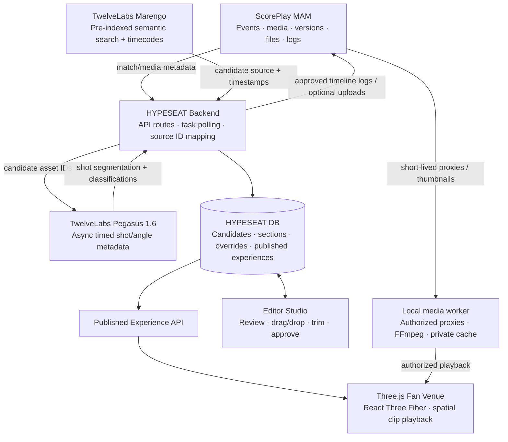

> **SUPERSEDED:** Historical stadium-first proposal. The current editor-first scope is in ../../design.md. API observations remain historical evidence; do not use this file as the active implementation plan.

# HYPESEAT — Product & Technical Design

**Spurs² Hackathon · October 22–23, 2026**  
**Challenge:** Assisted Auto-Production Engine  
**Primary user:** Club media editor / digital content producer  
**Secondary user:** Fan exploring a venue and considering tickets  
**Status:** Hackathon MVP specification, revised October 22, 2026 using both onboarding decks, current official documentation, and authenticated TwelveLabs inventory/search/segmentation tests. ScorePlay connectivity, playback, rendering, and editor → fan publishing remain untested in this revision.

> **Positioning:** ScorePlay holds the moments. TwelveLabs understands the footage. HYPESEAT turns the best moments into spatial, editor-approved experiences inside a 3D stadium.
>
> **Fan promise:** *Don't just see the seat. Feel the moments that make you want to be there.*

---

## 1. Executive summary

HYPESEAT is an **AI-assisted spatial media production platform**. It has two connected surfaces:

1. **HYPESEAT Studio (the actual product for this hackathon):** A media-team dashboard that takes existing match footage from ScorePlay, uses TwelveLabs to discover memorable clips and classify usable high/wide/sky-camera perspectives, proposes placements in stadium sections (e.g., `214`), and lets an editor preview, trim, move, reject, sequence, and approve those placements.
2. **HYPESEAT Venue (the output):** A Three.js stadium or arena in which approved moments appear at their editor-approved sections. Fans explore seating areas, view editor-curated moments with their actual source venue identified, and have a natural route to a ticket call-to-action. The supplied football match is an **away game at Old Trafford**; in a Tottenham home-stadium model it must appear as **related archive content**, rather than a memory of action at that home venue. For the hackathon, the ticket CTA is a **demo-only handoff**, not a real checkout integration.

**Critical demo interaction:** The mapping engine uses Pegasus shot metadata to propose a section experience (a themed archive association for the supplied away fixture) → the editor drags the highlight from Section 214 to Section 117 → clicks **Approve & Publish** → the fan-facing 3D stadium immediately displays the highlight in Section 117, not 214. Both views use the same published assignments in our database.

**This is an auto-production workflow, not merely a searchable video library:** the system discovers candidate highlight moments, selects suitable shots, generates section-specific media playlists/experience packages, proposes geographic placement, documents why it chose/rejected clips, and leaves final editorial control to a person.

### Objectives

- Make large quantities of ScorePlay match footage usable without manually scrubbing full games.
- Turn **existing footage** into a *new media format*: browsable experiences organized by venue sections.
- Make AI's role clear: **find → classify → propose → assemble**, while editors **correct → approve → publish**.
- Demonstrate one real end-to-end workflow for **Tottenham Hotspur football** and **San Antonio Spurs basketball** using the organizers' preloaded content.
- Show a commercially meaningful use case (ticket interest) without claiming unmeasured ticket-sales lift.

### Non-goals for the 2-day MVP

- Physically reconstructing a match from a single video or synthesizing an authentic new spectator POV.
- Mapping video to an **exact seat/row** with Pegasus alone.
- Building a new MAM, a rights-compliance engine, or a full professional NLE (nonlinear editor).
- Building a production ticketing integration or distributing event media publicly.
- Automatically creating location-perfect footage for all venue sections when source angles do not exist.

---

## 2. Source material & platform constraints

### Sources reviewed and evidence boundaries

This revision uses two supplied onboarding decks: **ScorePlay — How ScorePlay works, and how to build on it** (26 slides; **SP** below), and **TwelveLabs — Build with TwelveLabs** (25 slides; **TL** below), plus current official TwelveLabs API/SDK/billing documentation and the ScorePlay documentation/Postman collection. Section 17 links the sources. **LIVE** below means observed with the supplied TwelveLabs credential on October 22; **DOC** means documented but not exercised; **PROPOSED** means HYPESEAT behavior still to implement. Prior repository test reports are historical evidence from another run, not proof of this credential or dataset.

The earlier design also cited a separate builder brief and conversations with organizers. Those were **not supplied for this revision**. Claims carried forward from them are identified below rather than presented as verified by these decks.

### Verified platform and content facts

| Topic | Evidence and design consequence |
|---|---|
| Football dataset | SP 4 and 11 show **476 media: 418 photos and 58 videos**, including a Manchester United–Tottenham full match (6,334 seconds), phone footage, press content, social edits, and graphics. Counts describe the presentation snapshot; query the team's instance for its current inventory. |
| Actual venue | SP 11 identifies the fixture as **Away / Old Trafford / Week 6 / 2026–27**. Do not place it in Tottenham Hotspur Stadium as a historical event at that venue. A home-stadium demo may use a clearly labeled archive association; alternatively model the actual source venue. |
| Team-specific IDs | SP 16 states that teams receive the same content with **different platform IDs**. Discover the team's collection, media, player, tag, and company IDs; never copy slide example IDs into configuration. |
| Library hierarchy | A collection is an API **Event**; each media belongs to one collection, contains versions, and each version contains files. Collection tags are inherited by media (SP 8, 11–12). Preserve the source version as well as the media ID. |
| Existing metadata | Player/sponsor detection covers photos and the **first two minutes of video**; transcript processing covers the full video. The shown full match has media-level player tags and **no timeline logs** (SP 13–14). A whole-video player tag does not locate that player or action in a later clip. |
| Processing | ScorePlay supplies media and proxies, but **no editing or compute for this hackathon**. Download an authorized proxy and cut, stitch, crop, or overlay locally with FFmpeg (SP 19, 21). This corrects the earlier blanket ban on downloads; it does not authorize external distribution. |
| AI models | Index search uses **Marengo 3.0**; Marengo 3.5 supplies standalone embeddings. Analyze calls must explicitly select **`pegasus1.6`**, otherwise the deck warns of a 1.5 fallback (TL 8–9, 12–13, 23). |
| Pegasus limits | TL 12 and 15–16, plus the current API/SDK references, describe **20 images** or **20 segment definitions**, not 20 input videos. The segmentation guide still says **10 definitions**. This documentation conflict is unresolved; HYPESEAT uses **one definition per task**, which passed a live test. |

### Live credential and dataset audit — October 22, 2026

| Check | Observed result | Consequence |
|---|---|---|
| Authentication and indexes | `GET /indexes` returned **200**, with one visible index: **`premiere-league`**, ID **`6ad90f31960d8ea7bdd040ab`**, configured for `marengo3.0` with `visual` and `audio`. | Reuse this index. The spelling is the actual index name. Account visibility is limited to what this key can access. |
| Complete indexed inventory | Two pages at `page_limit=50` yielded **58/58 ready indexed videos**, totaling **10,257.044 seconds**. | Always follow `page_info`; the first page misses eight videos. No basketball index was visible. |
| Uploaded asset inventory | `GET /assets` reported **476 total assets**; the first page included photos. All 476 asset types were not enumerated in this audit. | Asset count and indexed-video count are different; do not claim that 476 videos are searchable. |
| Source join | All **58** indexed videos contained `user_metadata.scoreplay_id`, `scoreplay_event_id`, `scoreplay_rendition`, and `scoreplay_type`. | The actual join is **`user_metadata.scoreplay_id`**, not an unspecified custom-ID field. Values are strings. Confirm their ScorePlay instance before writing back. |
| Shapes and framing | **32** videos are 608×1080; **19** are 1700×1080; **6** are 1920×1080; **1** is 1280×720. Many filenames indicate social edits or motion graphics. | Pixel dimensions and filenames can shortlist candidates, but neither proves a usable camera angle. Analyze shots inside an edit. |
| Full-match source | Ready asset: **6,334.997 seconds**, **1280×720**, **25 fps**, **2,597,948,725 bytes**, H.264/AAC. Technical metadata includes `start_timecode="17:26:14:13"`. | Use the existing 720p proxy for the demo; do not re-upload a 2.6 GB source. File timecode is distinct from the clip offsets returned by search. |
| Search by indexed ID | Multipart `POST /search`, filtered to the full-match indexed ID, returned **200** in **0.62 seconds**; top five hits all referenced that source. | The request shape and `filter.id` path worked. This is a latency observation, not an SLA or accuracy measurement. |
| Search by source metadata | Search with `filter={"scoreplay_id":"130849278"}` returned **200** in **0.40 seconds**, with two hits from the corresponding fan-reaction edit. | Metadata filtering and `include_user_metadata=true` worked without changing existing metadata. |
| Timed analysis | One Pegasus 1.6 task analyzed **4750.099609375–4774.099609375** of the full match. It completed `ready`, `finish_reason="stop"`, with four shots, **58 seconds** after creation. | Source offsets were preserved in this bounded test; cache results and show async progress. Do not add the requested start offset again. |
| Other account state | Before the test, the task list and knowledge-store list were empty. | Jockey is not provisioned here. The audit created one short analysis task; it did not create an index, store, upload, or ScorePlay writeback. |

**Verification limits:** This credential verifies TwelveLabs access and the preloaded metadata, not access to the referenced ScorePlay company. No ScorePlay key was supplied or tested. No club media was downloaded or published during this research. Model descriptions and boundaries have not been checked frame by frame, so they are **provider output**, not verified camera geometry or scorer identity. `result.usage` was empty; the test does not establish price, remaining credits, or account plan.

### Carried-forward event assumptions to verify

- **Resolved for the visible football index:** footage is pre-indexed and the join field is `user_metadata.scoreplay_id`. **Still open:** which ScorePlay company issued those source IDs, and whether the team's own instance uses identical IDs. SP 16 warns that team copies have different IDs. Verify a source record before treating the join as writeback-safe; never fall back to a filename-only match silently.
- The **San Antonio NBA playoff dataset**, its index mapping, and actual venue remain requirements from the prior brief. The supplied credential exposes no basketball index, and neither reviewed deck identifies that game's inventory. Keep the second-sport adapter and acceptance target, but treat its demo as blocked on locating the correct dataset/key rather than fabricating a basketball result.
- Event-only access, no external public release or sharing, post-event cleanup, and the judging rubric remain carried-forward constraints pending the actual builder brief. Authorized local proxy downloads are specifically described in SP 19; confirm any additional storage or retention restrictions with organizers.
- Camera-angle tags were mentioned in prior organizer discussions, but the decks do **not** demonstrate a reliable camera-location/angle taxonomy. Inspect real tags and use Pegasus shot analysis plus a manual venue-region table as the fallback.

### Venue and camera integrity

Store the **source match venue** separately from the **display venue**. Use `related_archive_moment` for an away-game clip associated with a home-stadium section, display its source venue beside the player, and record editor approval. Only use `related_in_venue_moment` when the source venue matches the modeled venue. A mismatch blocks the in-venue claim; it does not prevent explicitly labeled archive curation.

For the first build, prioritize **SkyCam, overhead, elevated wide, and other unobstructed contextual shots**, using only available footage. These can support orientation analysis but are not necessarily spectator views. A section is an **editorial association** unless the actual camera position is independently verified. If one recording exists, show its real angle and the approximate 3D seat context without manufacturing another angle.

---

## 3. End-to-end user stories

### Editor: produce an experience

1. Open **Studio → Matches**; choose the Manchester United–Tottenham away fixture or the San Antonio playoff game once its dataset is verified.
2. Press **Generate Experiences** (or inspect a precomputed batch).
3. The system uses ScorePlay match/player/event metadata to scope Marengo search, then proposes goals, dunks, celebrations, crowd reactions, and other dramatic footage from timestamped results. Media-level player tags alone are not moment detections.
4. Pegasus segments/analyzes each candidate and supplies structured camera-perspective metadata: `overhead/skycam`, `elevated_wide`, `sideline`, `close_up`, `broadcast_montage`, `unknown`; visible landmarks; rough venue orientation; and timestamped shot boundaries.
5. The rules layer keeps **eligible wide/contextual shots** and proposes a venue region / section. It distinguishes in-venue placement from related archive association, identifies the actual source venue, and sends unclear placements to **Needs Review**.
6. The editor opens a proposal, sees source clip and its original timecode, compares suggestions against the 3D venue, drags the clip from suggested Section 214 to Section 117, optionally trims it or adds a caption, and can see the immediate *draft preview*.
7. The editor approves an experience. The fan-facing stadium receives the **approved published version** and reflects the corrected placement and source-venue label. A configured writeback job records the approved source ranges and rationale in ScorePlay logs after the agreed taxonomy is in place.
8. The editor can unpublish or re-edit without modifying the original source footage.

### Fan: discover the experience

1. Pick **Tottenham Hotspur Stadium** or the **San Antonio arena** in the demo. The Tottenham view explicitly identifies the supplied away-match clips as archive associations from Old Trafford; confirm the basketball source venue before making in-venue claims.
2. Rotate/zoom the 3D venue and click a seating section.
3. The camera transitions to an approximate first-person seat view based on venue geometry.
4. A contextual overlay lists approved moments associated with that section; selecting one plays its **actual ScorePlay footage** or an authorized local proxy, with source venue, archive/in-venue association, and original camera perspective distinguished from the approximate seat view.
5. Fans can explore different sections and see different curated experiences. A demo ticket CTA shows the intended commercial handoff, with no actual transaction.

### Editor: correct a bad AI placement (must-show test)

Given a mapping-engine proposal `section_suggestion=214` based on Pegasus metadata, when an editor moves a clip to `section=117`, then publishes the change:

- The database stores both the **AI suggestion** and the **editor's final assignment**.
- The public demo only reads `published` assignments.
- Section 214 stops displaying that clip, while Section 117 begins displaying it.
- The audit record shows who changed the section, when, and (optionally) why.

---

## 4. System architecture



**Source of truth split:** ScorePlay remains the source of truth for media, original tags, versions, and authorized renditions. HYPESEAT is the source of truth for *editorial proposals, stadium-section assignments, review state, and published experiences*. The approved experience is a **manifest referencing ScorePlay assets and time ranges**, not a duplicate MAM record.

**ScorePlay writeback:** Complete the find → fetch → analyze → writeback loop shown in SP 25 by recording editor-approved time ranges and reasoning as source timeline logs, after agreeing the taxonomy with staff. HYPESEAT manifests remain authoritative for section placement and fan publishing. Track writeback status separately so a provider failure can be retried without changing a published assignment or duplicating logs. For HYPESEAT, source logs are the proposed core writeback; tags and rendered-output uploads are additional outputs.

---

## 5. Components and responsibilities

### ScorePlay adapter

**Connect and discover** (SP 16–18)

- Use base URL **`https://media.scoreplay.io/v1`** with server-only **`X-ScorePlay-Api-Key`**. Start with **`GET /whoami`** to verify the team company, user, and rights. A `401` can mean a missing right as well as an invalid key; do not blindly retry it.
- Obtain **`company_id` from a media record**, not `/whoami`; source-log creation requires it. Do not hardcode the example company ID or assume all admin-key rights exist for the team's key.
- Resolve player/tag IDs with **`GET /tag/search?query=...`**; substring matches require selecting the intended ID, not taking the first result.
- Read the collection tree with **`POST /event/search`**, body `{"sub_and_master": true}`. The deck shows a **bare array**, not a paginated `items` object.
- Query **`POST /media/search`** with supported fields such as `players`, `tag_options`, `event_id`, `event_ids`, `media_type`, and `transcript_query`. **`event_id` is not recursive**: enumerate descendants and send `event_ids` to include sub-collections.
- Unknown filter keys are silently ignored; `type` is not a substitute for `media_type`. `tag_options` uses AND semantics; validate IDs before combining them. During connectivity checks, a fake-ID filter should return zero rather than the unfiltered library.

**Read and play media** (SP 8–10, 13, 19–21)

- Read **`GET /media/{id}`**, preserving media ID, version, event/collection, inherited tags, player tags, `company_id`, source venue, frame rate, duration, and `tc_in`/`tc_out` where available.
- Distinguish library `date` from capture/match time: SP 9's date is when content was loaded. Use event metadata and `captured_time` where available; do not infer the fixture date from library ingestion.
- Retrieve available download formats with **`GET /media/{id}/formats/download`**. Prefer **`video_medium` (720p)** or **`video_large` (1080p)** for an authorized local proxy; the returned file URL is valid for **24 hours**. Store a durable asset reference and refresh the URL when necessary.
- Normalize rendition names: `media.files[].details` uses `photographer_quality`, `compressed_quality`, `thumbnail_quality`; `media.video.*` uses `proxy_large`, `proxy_medium`, `stream`, and previews; the download endpoint uses `original`, `video_large`, `video_medium` (photos: `original`, `compressed`). Inspect the actual payload before selecting a format.
- Play selected source ranges from a permitted proxy/stream. **Do not depend on a ScorePlay clipping/transcoding endpoint:** the deck explicitly puts editing on the team's machine. Use a local FFmpeg worker when an actual cut or stitched output is needed. Keep caches private and out of Git/public storage.
- Use **`GET /media/{id}/transcripts`** for timed speech and **`GET /media/{id}/logs`** for existing moments. Empty logs are expected initially; full-video tags do not supply clip boundaries.
- Treat `tc_in`/`tc_out` as **milliseconds since midnight**, not source-relative clip seconds or Unix timestamps. Keep Marengo/manifest/log offsets in **seconds from video start**. Photo alignment is `(photo.tc_in - video.tc_in) / 1000` only after confirming the same date and synchronized clocks; verify a frame manually and handle midnight rollover explicitly.

**Write back after editorial approval** (SP 22–25)

- Agree tag/log semantics with ScorePlay staff before writing. Create a source log through **`POST /video/logs`** with `company_id` and `video_logs[]`; each entry contains `media_id` and a `log` with **`start_offset` / `end_offset` in seconds**, `comment`, and agreed `raw_tags` / `player_ids`. Include the HYPESEAT experience/revision reference and selection reasoning in the comment. Read back through `GET /media/{id}/logs` to verify.
- Readback units differ: `timestamp` is whole seconds, while `start_timestamp` / `end_timestamp` are milliseconds. Normalize these in the adapter; do not send Unix timestamps as clip offsets. After a timeout, reconcile existing logs before retrying creation to avoid duplicates; no provider idempotency guarantee is assumed.
- Optional metadata outputs: **`POST /media/{id}/tags`** with `tag_option_ids` / `player_ids`, **`PUT /media/{id}/details`**, and a dedicated output sub-collection created through **`POST /event`**. Do not overwrite shared source descriptions or invent taxonomy values.
- Optional rendered reel: edit locally, initiate **`POST /upload/event/{collection_id}?parts=1`** with the filename, PUT bytes to the returned URL and retain the **ETag**, then call **`POST /upload/complete/{media_id}`** with the returned key/upload ID and parts metadata. Poll media through `WAITING → PROCESSING → TRANSFORMED → DONE`; do not expose a pending upload as playable. SP 24's processing-time example is not a latency guarantee.

### TwelveLabs adapter

**Assets, credentials, and ID mapping** (TL 3, 5–6, 23)

- Use a current supported SDK; the deck uses REST base **`https://api.twelvelabs.io/v1.3`** and header **`x-api-key`**. Verify the installed SDK's request types before translating its Python examples to TypeScript.
- Keep **ScorePlay media ID**, **TwelveLabs `asset_id`**, and **indexed-asset `_id`** as distinct values. In the live search results, **`video_id` equals the indexed-asset `_id`**, not its underlying `asset_id`. Resolve it through the fully paginated indexed inventory; `user_metadata.scoreplay_id` gives the origin ScorePlay ID. Preserve the origin instance and reconcile it with the team's instance before writeback. [Indexed-asset reference](https://docs.twelvelabs.io/v1.3/api-reference/index-content/retrieve).
- Reuse supplied ready assets/indexes. If approved ingestion is necessary, use a **direct media URL or file**, not a YouTube/Google Drive/Dropbox page. The deck lists URL uploads up to 4 GB, local-file uploads up to 200 MB, and multipart up to 10 GB; use the method appropriate to the actual media size. ScorePlay URLs expire, so ensure they remain usable for ingestion.
- Poll asset ingestion, indexing, and any knowledge-store items until ready before dependent calls. For `429`, honor `Retry-After`; use bounded exponential backoff with jitter for transient failures. Track `X-Ratelimit-Dimensions` and applicable limit/remaining/reset headers. A task-creation timeout is ambiguous: reconcile persisted task IDs or `custom_id` before resubmitting. [Rate-limit reference](https://docs.twelvelabs.io/v1.3/docs/get-started/plans-and-billing/rate-limits/new-billing).

**Marengo — retrieval** (TL 8–10, 21)

- Search the provided **Marengo 3.0** index through the SDK or raw **multipart/form-data `POST /search`**, as tested here. Do not send a JSON search body or hardcode a multipart boundary when using `FormData`. Use `group_by=clip`, bounded `page_limit`, a stringified JSON `filter`, and `include_user_metadata=true`. `filter.id` takes indexed-asset IDs; `filter.scoreplay_id` matches the source metadata string. **Marengo 3.5 is for standalone embeddings**, which the MVP does not need. [Search API](https://docs.twelvelabs.io/v1.3/api-reference/any-to-video-search/make-search-request).
- Results include `video_id`, `start`, `end` (source-relative seconds), and `rank` (**1 is best**); the tested hits had no numeric confidence score. Rank is not a probability. The tested `search_pool.total_count=58` described the index even when result hits were filtered to one video: validate returned IDs, rather than treating that pool count as the filtered asset count. Search pagination uses expiring tokens; consume the returned page token via the documented page endpoint and cache normalized hits, not tokens as durable IDs.
- Search moments such as a wide view of a Tottenham goal or a dramatic high-camera dunk. Deduplicate overlapping windows; returned boundaries remain editable candidates.
- Optional later: entity search can use a roster collection and multiple reference photos per player. It is beta in TL 10 and is not required for the MVP.

**Pegasus 1.6 — classification and timed segmentation** (TL 12–16)

- Always set **`model_name="pegasus1.6"`**. General mode uses `prompt` and optional JSON schema; timed mode uses segment definitions. Set temperature to `0` to reduce variability. **DOC:** synchronous analysis supports up to one hour; async analysis supports a two-hour analyzed window and sources up to four hours when windowed (HLS/base64 retain a two-hour source limit). **LIVE:** bounded async analysis succeeded on the 6,334.997-second source. [Pegasus input requirements](https://docs.twelvelabs.io/v1.3/docs/concepts/models/pegasus/pegasus-1-6).
- For general JSON output, parse **`res.data` as a JSON string** and validate the schema. `finish_reason="length"` indicates truncation; request adequate `max_tokens` or reduce the range. A larger token budget is not evidence of accurate localization.
- For timestamped shot extraction, create **`analyze_async.tasks.create`** with `analysis_mode="time_based_metadata"` and `response_format.type="segment_definitions"`. **Do not pass a general-mode prompt**: segment and field descriptions express the extraction instructions. Configure `min_segment_duration` / `max_segment_duration` to suit the shots.
- One Pegasus 1.6 task analyzes **one video**; queue tasks with bounded concurrency. The deck/API/SDK say **20 segment definitions**, while the narrative guide says **10**; the live test proves one, not either maximum. Use one `camera_shots` definition. The separate image limit is **20 images**. A batch-analysis endpoint exists for **Pegasus 1.5**, so it is not the batching mechanism for this 1.6 pipeline. [Segmentation guide](https://docs.twelvelabs.io/v1.3/docs/guides/segment-videos), [migration guidance](https://docs.twelvelabs.io/v1.3/docs/get-started/migration-guides/pegasus-1-5-to-1-6).
- Poll **`GET /analyze/tasks/{task_id}`** until `ready`, `failed`, or `canceled`; `queued`, `pending`, and `processing` are intermediate. For `ready`, inspect `error` and `result.finish_reason` **before** parsing JSON-string **`result.data`**. A ready task can still carry an incomplete-output warning. Reject malformed, truncated, or out-of-range output from auto-approval. [Task-result contract](https://docs.twelvelabs.io/v1.3/api-reference/analyze-videos/retrieve-analysis-task-status-results).
- Request camera changes, view type, visible geometry, and uncertainty. Split montages into timestamped shots; neither segmentation nor Pegasus directly proves a camera location or section number. Check model boundaries in preview and send ambiguous results for review.

**Parameter and schema guardrails — DOC, with one successful timed task**

- Explicitly set `response_format.segment_time_format="seconds"`; automatic boundaries then remain numeric. For custom `timestamp` fields, specify their own format. `min_segment_duration` has a **2-second minimum**; very rapid broadcast cuts can therefore need manual boundary correction.
- With a fixed token limit, segmentation fails rather than returning a usable partial result when output overruns. `max_tokens="unlimited"` is specific to Pegasus 1.6 timed metadata and can still return incomplete results with a warning. It is not an accuracy guarantee. HYPESEAT uses `4096` for short windows and retries a narrower window after an output-limit failure. Avoid combining top-level window/duration controls or unlimited tokens with per-definition `time_ranges`, which have mutually exclusive options. [Async request contract](https://docs.twelvelabs.io/v1.3/api-reference/analyze-videos/create-async-analysis-task).
- The Node SDK uses `analyzeAsync.tasks.create`, `modelName`, `responseFormat`, `segmentDefinitions`, `assetId`, and `taskId`; REST/Python examples use different casing. Pin a tested SDK version or use the raw REST contracts below. [Node SDK](https://docs.twelvelabs.io/v1.3/sdk-reference/node-js/analyze-videos/async-analysis).
- For general JSON-schema mode, the documented subset excludes `additionalProperties`, `maxItems`, `uniqueItems`, and string-length constraints. Avoid passing a generic strict schema unchanged. Keep timing and enum validation in the application; put extraction instructions in the prompt. Timed metadata instead requires descriptions on segment fields. [Request/schema reference](https://docs.twelvelabs.io/v1.3/api-reference/analyze-videos/create-async-analysis-task), [structured-output guide](https://docs.twelvelabs.io/v1.3/docs/guides/analyze-videos-and-images/structured-responses).

**Mapping engine — our original contribution**

- Normalize Pegasus perspective classifications and any verified ScorePlay camera-angle tags.
- Keep eligible contextual shots, then use source venue, visible goal/basket, directional cues, camera family, and configured region/section geometry to propose candidate sections.
- For same-venue footage, rank plausible region associations and preserve reasons/confidence. Return **unmapped** when evidence is insufficient.
- For away footage displayed in a home venue, propose only an explicitly labeled **archive association**, with editor confirmation; do not infer a home section from Old Trafford geometry.
- Keep final section choice with the editor. An association does not establish that footage was recorded from the selected seat.

**Jockey — optional post-MVP** (TL 17–22)

Jockey can plan retrieval and analysis over a **knowledge store**, answer with cited moments, and support follow-ups. It is not required for the direct Marengo → Pegasus pipeline. If added, reuse assets, add them to a store, poll items until ready, and call `responses.create` with `knowledge_store_id`; use `session_id` for follow-ups. Its cited results still pass through the same venue checks and editorial approval.

---

### HYPESEAT Studio

Three areas, designed for fast production:

1. **Media tray (left):** Auto-generated clip candidates, thumbnails, match/player labels, timestamps, original asset reference, `AI confidence`, `eligible / excluded / needs review` filters.
2. **Stadium map (center):** Clickable 3D/top-down section view with numeric section IDs; AI suggestions appear as highlighted target areas; drag a clip onto a section or choose section in a picker.
3. **Inspector/editor (right):** Video preview, original view classification, original vs. edited section, trim handles, headline/caption, show/hide in experience, reject reason, approval controls.

Additional UI: **Draft / Needs Review / Approved / Published / Rejected** tabs; a small experience playlist/timeline ordered by the editor; compare **AI placement vs. editor placement**; recent changes/audit trail.

### HYPESEAT Venue

- One venue configuration per club, with each section assigned a stable identifier and 3D transform.
- Load only **published** section experience manifests.
- On section click: camera `flyTo(section.viewpoint)` → section info overlay → clip thumbnails/player.
- Show `Original source footage`, `Approximate seat view`, `Related in-venue moment`, or `Related archive moment — filmed at Old Trafford` as applicable. Reserve any verified camera-position claim for independently confirmed evidence.
- Expose a demo ticket call-to-action. Do not fabricate prices, inventory, or purchase confirmations.

---

## 6. Data model

The following are **application-level schemas**, not claims about provider response payloads.

| Entity | Important fields | Purpose |
|---|---|---|
| `Venue` | `id`, `club`, `name`, `sport`, `geometryConfig` | One stadium/arena and its section map |
| `Section` | `id`, `venueId`, `label` (`"214"`), `centroid3d`, `cameraPose`, `region`, `nearTarget` | Geometric target for fan view and editorial placement |
| `Match` | `id`, `scoreplayEventIds[]`, `sourceVenueId?`, `teams`, `sourceVenueConfirmed` | Source match, collection descendants, and actual home/away venue |
| `SourceAsset` | `scoreplayOriginMediaId`, `scoreplayOriginEventId`, `scoreplayAssetId?`, `scoreplayVersionId?`, `companyId?`, `joinStatus`, `twelveLabsIndexId`, `twelveLabsAssetId`, `twelveLabsVideoId`, `matchId`, `assetType`, `durationSec`, `fps?`, `containerStartSec?`, `tcInMs?`, `tcOutMs?`, `mediaUrlRef`, `urlExpiresAt?`, `sourceCameraTag?` | Preserve imported origin IDs separately from the reconciled team media ID; search video ID is indexed-asset `_id` |
| `ClipCandidate` | `id`, `assetId`, `startSec`, `endSec`, `eventType`, `shotType`, `landmarks`, `teamRelation`, `retrievalRank`, `placementScore?`, `status`, `rejectionReason?` | Distinguish retrieval order, placement heuristic, and home/opponent/unknown attribution; no invented provider probability |
| `PlacementProposal` | `clipId`, `suggestedSectionIds`, `suggestedRegion`, `reason`, `confidence`, `algorithmVersion` | Preserves original AI recommendation |
| `Experience` | `id`, `venueId`, `matchId`, `title`, `status`, `revision`, `publishedAt?` | Display venue and approved revision; match stores the distinct source venue |
| `ExperienceClip` | `experienceId`, `clipId`, `sectionId`, `sortIndex`, `trimStartSec`, `trimEndSec`, `caption`, `placementKind`, `approvedBy?`, `approvedAt?` | **Final human-editable assignment**; kind is `related_in_venue_moment`, `related_archive_moment`, or independently verified `verified_camera_view` |
| `EditorialEvent` | `id`, `editorId`, `type`, `clipId`, `fromSection?`, `toSection?`, `reason?`, `timestamp` | Audit trail / review evidence |
| `ProviderTask` | `id`, `provider`, `assetId`, `range?`, `promptVersion`, `remoteTaskId`, `status`, `attempts`, `error?` | Durable async analysis and bounded retries |
| `ScorePlayWriteback` | `experienceId`, `revision`, `clipId`, `kind`, `status`, `remoteLogId?`, `outputMediaId?`, `error?` | Reconcile source logs/uploads and retry independently of fan publishing |

**Invariants:** `PlacementProposal` never overwrites `ExperienceClip.sectionId`: the first is the AI proposal; the second is the authoritative editorial choice. Store clip/trim/log offsets in seconds from the source video start, separately from ScorePlay time-of-day milliseconds. Source venue and display venue are separate; a mismatch requires `related_archive_moment` plus an explicit source-venue label, never an in-venue or verified-camera claim.

### Verified source identifiers — account snapshot, not universal constants

| Source | Origin ScorePlay media ID | TwelveLabs `asset_id` | Indexed `_id` = search `video_id` |
|---|---|---|---|
| Full match, 6,334.997s | `130849212` | `6ad90e1a030b76724d135bf2` | `6ad90f3c9c038876f358a41b` |
| 16:9 key highlights, 121.834s | `130849210` | `6ad90e1a65b4aff96dc7a8c2` | `6ad90f3d500e82756f2ea8a4` |
| Fan-reaction edit, 17.216s | `130849278` | `6ad90e150ca748ea3c0a93bb` | `6ad90f4f968fe117efe6fa7c` |

These are **live imported metadata IDs**, not the slide examples and not yet verified against the team's ScorePlay instance. The full match's origin collection is `1536073`; key highlights use `1536066`; the fan edit uses `1536069`. Configure them server-side and verify again if the event account changes. Section numbers **214/117 remain illustrative UI identifiers**, not verified venue geometry.

**Illustrative backend output** (not a real AI result):

```json
{
  "clipId": "clip_027",
  "source": {
    "scoreplayAssetId": "SCOREPLAY_ASSET_ID",
    "twelveLabsAssetId": "TWELVELABS_ASSET_ID",
    "twelveLabsVideoId": "TWELVELABS_SEARCH_VIDEO_ID",
    "sourceVenue": "Old Trafford",
    "startSec": 2682.4,
    "endSec": 2695.8
  },
  "analysis": {
    "shotType": "elevated_wide",
    "skycamEligible": true,
    "visibleLandmarks": ["near_goal", "touchline", "opposite_stand"],
    "cameraView": "high_angle_from_sideline",
    "momentType": "goal_celebration",
    "spatialConfidence": "medium"
  },
  "proposal": {
    "suggestedSections": ["214", "215"],
    "reason": "Editorial archive association in the Tottenham home-stadium demo; source footage is from Old Trafford, with no home-section camera claim"
  },
  "editorial": {
    "finalSection": "117",
    "status": "approved",
    "placementKind": "related_archive_moment"
  }
}
```

### Suggested backend endpoints (ours, not provider APIs)

```text
GET    /api/matches                         list configured matches
POST   /api/matches/:id/discover            run/cached candidate discovery
GET    /api/matches/:id/candidates          AI proposals, exclusions, explanations
GET    /api/jobs/:id                        async discovery / analysis progress
GET    /api/venues/:id/sections             geometry + section metadata
POST   /api/experiences                    create draft from AI proposals
PATCH  /api/experiences/:id                 edit metadata/order/captions
PATCH  /api/experiences/:id/clips/:clipId   trim, assign section, exclude
POST   /api/experiences/:id/publish         validate + commit approved revision
POST   /api/experiences/:id/unpublish       hide from fan view
GET    /api/public/venues/:id/sections/:sectionId/experiences
```

Return a compact **published experience manifest**, not provider API keys or unapproved clips. Preview should be separate from published state.

---

## 7. Discovery, classification, and mapping pipeline

### Step A — Find candidate clips

1. Get match collection from ScorePlay.
2. Enumerate descendant collection IDs and paginate the TwelveLabs indexed inventory completely. Resolve `video_id → indexed _id → asset_id + user_metadata.scoreplay_id`; verify the origin/team ScorePlay namespace before a writeback. The live football join field is known; its destination-company match is still pending.
3. Run a **small fixed query bank** for each sport (then let producer supply optional custom queries):
   - Football: `goal and aftermath`, `fans erupting after a goal`, `penalty area attack wide camera`, `players celebrating with supporters`.
   - Basketball: `dramatic dunk wide court view`, `block near the basket`, `crowd erupting after big play`, `late-game three-pointer and reaction`.
4. Deduplicate overlapping Marengo timestamp windows from the same asset.
5. Filter to the selected match and footage allowed by the hackathon data rules.
6. Submit a few top candidate windows (for example, 20–30 seconds with padding) to per-video Pegasus 1.6 tasks; cache and poll them. Do not analyze the full match for every query. Check team attribution as well as action type: a generic goal search can return the opponent's celebration.

### Step B — Structured Pegasus extraction

Default to async **time-based metadata** with one `camera_shots` definition; this passed the live test. Its description asks for camera changes, and its fields describe view type, visible geometry, and uncertainty. Use `response_format.type="segment_definitions"`, not the general-mode JSON-schema request. Definition count is not the number of returned shots, and it is not a multi-video input count; the documented maximum is inconsistent across guides (see section 5).

Normalize provider `start_time` / `end_time` plus `metadata` into an application schema containing fields like:

```text
shot_start, shot_end,
shot_type: skycam | overhead | elevated_wide | sideline_wide |
           spectator_pov | field_level | close_up | montage | unknown,
scene_description,
sport, visible_landmarks[],
field_side: near_goal | far_goal | center | left | right | unknown,
crowd_reaction: none | moderate | intense | unknown,
source_is_edited_montage: boolean,
spatial_clues[],
needs_review: boolean
```

**Segment-description intent:** Split at camera changes, identify overhead/elevated views, describe visible geometry, and return `unknown` for unsupported orientation or camera-location claims. Put this intent in segment/field descriptions for time-based metadata, which takes no general-mode prompt. If general analysis is used as a fallback on a bounded range, express it through `prompt` with a JSON schema and validate the returned timestamps.

Poll to a terminal state, check completeness/warnings, parse `result.data`, validate numeric times and source/window bounds, and inspect shot boundaries. **LIVE:** the tested bounded response used source offsets starting at 4750.099609375, not a new zero-based range. Preserve these; do not add the window start again. Other sources still need a clock check. Keep file presentation start (`ffprobe format.start_time`), embedded source timecode (`17:26:14:13` here), and ScorePlay milliseconds-since-midnight as separate values. Incomplete or failed extraction cannot auto-publish.

**Why segmentation matters:** The source might be a montage with scoreboard overlays and zoomed close-ups. We need to extract the eligible timestamped **shots inside the montage**, not attach a single section to the whole edited video.

### Tested request and actual result

**Search — raw REST request shape, successful live test:**

```typescript
// Server-only; set the key through the process environment or a secret manager.
const form = new FormData();
form.set("index_id", "6ad90f31960d8ea7bdd040ab");
form.set("query_text", "A wide broadcast view of a football goal followed by players celebrating");
form.append("search_options", "visual");
form.set("group_by", "clip");
form.set("page_limit", "5");
form.set("filter", JSON.stringify({ id: ["6ad90f3c9c038876f358a41b"] }));
form.set("include_user_metadata", "true");
const response = await fetch("https://api.twelvelabs.io/v1.3/search", {
  method: "POST",
  headers: { "x-api-key": process.env.TWELVELABS_API_KEY! },
  body: form, // Let fetch supply Content-Type and the multipart boundary.
});
if (!response.ok) throw new Error(`TwelveLabs search returned ${response.status}`);
const hits = await response.json();
```

This is a minimal transport example; the adapter adds retries, response validation, pagination, and redacted errors. The same request using `filter={"scoreplay_id":"130849278"}` returned only the corresponding fan-reaction edit. The test used visual search; the index also supports audio, but this audit did not compare modality quality.

**Segmentation — tested JSON body for `POST /analyze/tasks`:**

```json
{
  "model_name": "pegasus1.6",
  "custom_id": "hypeseat-research-20261022-shots",
  "video": {
    "type": "asset_id",
    "asset_id": "6ad90e1a030b76724d135bf2"
  },
  "analysis_mode": "time_based_metadata",
  "start_time": 4750.099609375,
  "end_time": 4774.099609375,
  "temperature": 0,
  "max_tokens": 4096,
  "min_segment_duration": 2,
  "response_format": {
    "type": "segment_definitions",
    "segment_time_format": "seconds",
    "segment_definitions": [
      {
        "id": "camera_shots",
        "description": "Within the requested analysis window, identify each continuous camera shot. Split at camera cuts. Describe only visible evidence. Do not infer a stadium section, exact seat, camera position or identity. Return unknown when uncertain.",
        "fields": [
          {
            "name": "view_type",
            "type": "string",
            "description": "Camera framing: elevated_wide, sideline_wide, overhead, field_level, close_up, graphic, or unknown."
          },
          {
            "name": "scene",
            "type": "string",
            "description": "Brief description of the visible action and camera changes, without inferring player names."
          },
          {
            "name": "needs_review",
            "type": "boolean",
            "description": "True if the shot boundaries, angle or spatial interpretation are uncertain."
          }
        ]
      }
    ]
  }
}
```

Task **`6ada433f3eff3c9c9fc634aa`** returned these **model classifications**, not independently verified camera positions:

| Source seconds | Provider view type | HYPESEAT treatment |
|---|---|---|
| 4750.099609–4752.099609 | `field_level` | Excluded from wide-only placement; optional editorial context |
| 4752.099609–4757.099609 | `sideline_wide` | Wide-shot candidate; inspect before approval |
| 4757.099609–4770.099609 | `close_up` | Excluded from wide-only placement; optional editorial context |
| 4770.099609–4774.099609 | `close_up` | Excluded from wide-only placement; optional editorial context |

The task reported `finish_reason="stop"` and no warning; its server timestamps show **58 seconds** from creation to completion for a **24-second** window. One five-second shot is potentially eligible; nineteen seconds are field-level/close-up context. The model described red-shirted players celebrating in the wide shot, so **desired-club versus opponent attribution needs review** before any Tottenham-focused headline. All four model `needs_review` flags were false, which does not establish editorial suitability, boundary accuracy, venue geometry, or scorer identity. Store the raw classification and apply HYPESEAT's independent review rules.

### Step C — Candidate scoring (simple, explainable)

For each shot, score:

- **Camera suitability (40%)** — strict preference for skycam/elevated wide, readable pitch/court layout.
- **Moment impact (25%)** — goals/dunks/decisive plays/crowd reactions; heuristics, not made-up historic significance.
- **Spatial clarity (20%)** — can we tell which basket/goal/region is visible? Use this only for same-venue association; it does not validate a home-section location for away footage.
- **Media quality (15%)** — duration, resolution, obstruction, useful audio.

An `unknown` or conflicting camera view goes to **Needs Review**. Reject close-ups if the objective is **skycam-only** placement, but keep them in the rejected/alternate list with reasons. The editor may re-enable them intentionally as **supplemental content**.

**Team-attribution gate:** Record `teamRelation=club | opponent | neutral | unknown` with its evidence. An unverified generic goal result cannot receive a club-celebration caption automatically. Editors may intentionally include opponent/context footage, but the caption and experience intent must match. Retrieval rank and model `needs_review=false` never override this gate.

### Step D — Stadium mapping

**MVP rule-based mapping** (not exact 3D camera calibration):

1. Resolve the actual source venue from ScorePlay event metadata and compare it with the display venue. Old Trafford footage in a Tottenham home-stadium model enters **archive association** mode; skip geometric section inference across the two venues.
2. For same-venue footage, use the venue's configurable **region → section** lookup table (`north_goal`, `south_goal`, `east_sideline`, `west_sideline`, `center_court`, etc.). For archive mode, let an editor choose a themed section association without asserting source-camera geometry.
3. For same-venue mapping, combine a verified source camera tag, Pegasus shot type, and landmark cues to propose `sectionIds[]`. Archive proposals use a curated theme/section table and explicitly state that their placement is editorial.
4. If multiple sections are plausible, present a ranked short list and choose one *draft* section only when confidence meets our threshold; an archive proposal must not report this score as camera-location confidence.
5. Require editor approval. Retain the original AI suggestion for transparency.

**Do not conflate:**

- `camera_location` = where the recording was shot (often unknown);
- `event_location` = where the goal/dunk took place (sometimes inferable);
- `section_association` = which part of the stadium the editor chooses to associate the clip with.

HYPESEAT publishes `section_association` as the product output. It must not advertise it as authentic footage from that section unless `camera_location` is independently verified.

### Step E — Generate an experience package

For every draft target section, assemble **2–4 ranked candidate shots** as an ordered, editable playlist. Each playlist entry references the original media, time bounds, a caption, and a type (`action`, `crowd_reaction`, `celebration`, `context`). The first demo can play approved segments in sequence from a private authorized proxy; it does not require a new video render. When a rendered deliverable is useful, FFmpeg cuts/stitches it **locally**, optionally crops to 9:16 or overlays approved branding, and the adapter uploads it into a dedicated ScorePlay sub-collection. Log the approved source selections and rationale separately so the production loop is visible even when the output is a playlist manifest.

---

## 8. Editor UX, approvals, and live reflection

### Wireframe

```text
┌──────────────────────────────────────────────────────────────────────────────┐
│ HYPESEAT STUDIO       Tottenham v Man U       [Generate] [Preview] [Publish]│
├──────────────────────┬────────────────────────────────┬──────────────────────┤
│ CANDIDATE MOMENTS    │  INTERACTIVE STADIUM           │ INSPECTOR            │
│                      │                                │                      │
│ ✓ Wide goal clip     │      [214]   [215]             │ Source: ScorePlay    │
│   44:42–44:56        │   [117]   PITCH   [119]        │ Angle: elevated wide│
│   AI → Section 214   │                                │ AI section: 214      │
│                      │   drag a clip onto a section   │ Editor section: 117  │
│ ? Crowd reaction     │                                │ [Play] [Trim]        │
│   45:02–45:11        │                                │ [Reject] [Approve]   │
│                      │                                │                      │
│ ✕ Close-up replay    │                                │                      │
│   Rejected: no       │                                │                      │
│   stable wide angle  │                                │                      │
├──────────────────────┴────────────────────────────────┴──────────────────────┤
│ SECTION 117 EXPERIENCE:  [Goal 12s] → [Crowd 7s] → [Celebration 8s]          │
│ STATUS: Draft | source timecodes preserved | human approval required        │
└──────────────────────────────────────────────────────────────────────────────┘
```

### Required interactions

- `Generate`: trigger AI discovery with task progress/polling feedback; use cached source-backed results if already processed. A long-running task must not block the editor.
- `Add to section`: drag/drop clip, or fallback accessible dropdown `Assign to Section`.
- `Move`: change `ExperienceClip.sectionId` without overwriting `PlacementProposal`.
- `Trim`: set clip's in/out points; keep within source time bounds.
- `Reorder`: move clips within a section's playlist.
- `Reject / Restore`: reasons visible (e.g., `close-up`, `venue mismatch for in-venue claim`, `uncertain orientation`, `duplicate`). A labeled archive association can be approved separately.
- `Preview`: privately show the section experience in the 3D fan UI before publishing.
- `Approve & Publish`: atomically update the approved manifest; refresh fan page via subscription or polling.
- `Unpublish`: remove an experience from fan results without deleting any ScorePlay media.

**Publishing rules**

- Only `published` manifests reach the fan view.
- Every published clip has a resolvable source asset/version reference, valid source-relative time bounds, an assigned section, an appropriate placement kind, a source-venue label, reviewed club/opponent context, and an editor approval. ScorePlay writeback additionally requires a verified origin → team media join and the destination company ID.
- Moving a published clip creates a draft revision **until reapproved**; fans keep seeing the last approved revision. Approve & Publish atomically replaces it, removing the old assignment and adding the new one together.
- Failed playback should produce a graceful placeholder, not a broken venue.
- Unresolved rights, an unknown source venue for an in-venue claim, or a misleading venue/camera claim blocks publication. A known away venue is allowed only as an editor-approved, explicitly labeled `related_archive_moment`.
- Expired proxy links are refreshed server-side; do not persist a signed URL as the source identity.
- Show ScorePlay writeback as `pending / synced / failed` separately from publish state, with reconciliation before retries.

---

## 9. Frontend visual design

### Studio (production-focused)

- Dark, professional workspace; video thumbnails; numbered venue sections visible.
- Fast comparison of **AI suggestion** vs **human decision**.
- Visible confidence/uncertainty, rejected-media explanations, actual source venue, and an **Archive association** badge for away footage. Retrieval rank and our heuristic placement score are separate concepts.
- Preview and publish are distinct actions; approval should feel consequential.

### Venue (demonstration-focused)

- One **stylized but recognizable** football stadium and one basketball arena.
- Three.js/React Three Fiber allows orbit, pan, zoom, and smooth fly-to-section movement.
- Clickable regions have readable section labels (e.g., 117, 214) and visible selection state.
- Selecting a section opens a side panel with approved clips, source venue, archive/in-venue badge, source time and match labels, captions, and an obvious play control. For the supplied football fixture, show **Old Trafford · Away match** beside the footage in the Tottenham home-stadium demo.
- Keep actual video playback in an accessible HTML/video overlay; don't insist on projecting it onto complicated 3D surfaces unless time permits.
- Distinguish clearly between an **approximate 3D seat perspective** and the **real original video angle**. Never imply re-rendered historical action from that precise seat.
- Demo-only ticket CTA after the experience: `Explore tickets` / `See upcoming games`; no real ticket sale or pricing claims.

---

## 10. Proposed implementation stack

**Default fast-build stack** (adjust to team skills):

- **Web + backend:** Next.js App Router, TypeScript, Tailwind CSS, shadcn/ui.
- **3D:** Three.js through `@react-three/fiber` and `@react-three/drei`; simple parameterized stadium geometry or a licensed stadium model if available.
- **State:** TanStack Query for fetch/cache + lightweight local editor state.
- **Database:** Supabase Postgres for section assignments, clips, editorial events, and publish revisions. Supabase Realtime **or** polling every 2–5 seconds to update fan view; polling is adequate for the MVP.
- **Media:** ScorePlay authorized streams or 720p/1080p proxies, with selected source-relative start/end times. Private local cache and optional **FFmpeg** worker for cuts/stitching/reframing; refresh 24-hour file URLs. Keep protected content out of public CDNs and Git.
- **AI:** TwelveLabs SDK/API via server-only adapter, **Marengo 3.0 index search + explicit Pegasus 1.6 async timed metadata**. Jockey is optional after the core flow works.
- **Background work:** A local worker with persisted provider-task IDs, polling, and bounded retries for Pegasus; cache by `{assetId, segmentRange, modelVersion, schemaVersion}`. Track ScorePlay writebacks and optional uploads separately. No distributed job system is needed for two matches.

### Cost, limits, and operating budget

**DOC, not account-verified:** billing changed on **October 15, 2026**, with staged migration for existing accounts. Do not assume an event key has the legacy 600-minute free allowance. Current plans distinguish stored-asset allowance from workload usage; the exact account plan, remaining allowance, and spend must be checked in **Playground → Settings → Billing & Plans**. The successful API requests and empty `usage` object do not answer those questions. [Billing migration](https://docs.twelvelabs.io/v1.3/docs/get-started/plans-and-billing/migrate-to-new-billing), [allowances](https://docs.twelvelabs.io/v1.3/docs/get-started/plans-and-billing/plans-allowances-and-overage).

**PROPOSED default:** reuse the existing index, request five hits per query, analyze at most three deduplicated 20–30-second windows initially, run one analysis task at a time until capacity is understood, and cache by source/range/model/schema. These are application limits, not provider quotas. Preserve explicit start/end windows so each review does not reanalyze 105.6 minutes of footage. Surface budget/quota errors and reuse cached results; do not change the account plan or enable overage automatically.

Suggested repo structure:

```text
src/
  app/
    studio/page.tsx
    studio/matches/[matchId]/page.tsx
    venue/[venueId]/page.tsx
    api/
      matches/[id]/discover/route.ts
      experiences/[id]/publish/route.ts
      public/venues/[id]/sections/[sectionId]/route.ts
  components/
    studio/{CandidateTray,SectionMap,ClipInspector,ExperienceTimeline}.tsx
    venue/{StadiumScene,SectionMarker,ExperienceDrawer,ClipPlayer}.tsx
  lib/
    providers/{scoreplay,twelvelabs}.ts
    media/{proxy-cache,ffmpeg}.ts
    jobs/{polling,retry,scoreplay-writeback}.ts
    discovery/{queries,normalize,rank}.ts
    spatial/{venue-config,section-mapping}.ts
    editorial/{manifest,validation,publishing}.ts
  types/{media,experience,venue}.ts
  data/{football-venue,basketball-venue}.json
```

**Deployment:** Restrict the entire working demo to hackathon-approved access. If deployment or preview hosting outside the event environment is prohibited or unclear, run locally / on organizer-authorized infrastructure. Never push video assets, raw API responses with sensitive media links, or credentials to a public repo.

---

## 11. MVP scope, delivery order, and acceptance tests

### P0 — Must work before polish

1. **Provider connectivity:** TwelveLabs inventory/search/timed analysis now have live evidence. Next verify ScorePlay `/whoami`, company/media IDs, recursive collection filters, and the origin → team join. Locate the missing basketball index and resolve its source venue.
2. **One real clip pipeline:** Run Marengo 3.0 search → source-relative time range → Pegasus 1.6 async angle/shot metadata → reviewed venue-section association. Play an authorized proxy; refresh links if expired.
3. **Editor UI:** Display proposed sections; editor can move a clip to another valid section, reject, trim, and approve.
4. **Publish path:** Persist an approved manifest and display it in the 3D stadium with real source footage.
5. **Both sports:** A football experience and a basketball experience via the **same code path** with sport-specific venue configurations.
6. **Explainability and production loop:** Display at least one accepted and one rejected candidate with reasons and source venue. After taxonomy agreement, write and read back one approved source log; show pending/failed sync honestly if provider access blocks it.

### P1 — Strong finishing touches

- Assemble a **multi-clip** experience with ordered shots, captions, and optional crowd reaction.
- Draft preview embedded in the Studio.
- Fast live reflection across two browser windows after approval.
- Before/after comparison showing original suggested vs manually corrected section.
- An auto-generated section-specific title such as “Relive the Biggest Moments Near This End.”

### P2 — Only if ahead of schedule

- Multiple proposed sections per clip with confidence-ranked alternatives.
- Generative editor requests such as “Find another wide view of this moment.”
- Additional approved tag/details writeback or a local FFmpeg reel uploaded to a dedicated ScorePlay sub-collection; source timeline-log writeback is already in the core production loop.
- Analytics event capture for section exploration and ticket CTA intent.
- Real-time new-asset workflow using authorized ScorePlay webhooks.

### Acceptance criteria (demo can be judged objectively)

- **AC1:** Select Tottenham–Manchester United footage and get at least one real timestamped, playable clip into Studio.
- **AC2:** Select San Antonio playoff footage and repeat the flow without changing source code.
- **AC3:** Pegasus returns an identifiable shot classification for one candidate; `unknown` is allowed and reviewable rather than fabricated.
- **AC4:** A proposed Section 214 assignment can be moved to Section 117; published fan data changes accordingly.
- **AC5:** No unpublished or rejected item appears in the fan-facing venue.
- **AC6:** A video that contains multiple camera cuts is treated as multiple candidate shots (or rejected as an unsuitable whole montage), not blindly mapped as a single POV.
- **AC7:** Each published entry retains its source ScorePlay media ID and start/end time.
- **AC8:** The demo shows why at least one candidate was rejected.
- **AC9:** All video usage stays within hackathon-permitted environments and rights, including authorized local downloads and private caches.
- **AC10:** The Old Trafford fixture cannot publish as an in-venue memory at Tottenham Hotspur Stadium; archive mode requires its actual source venue and an explicit archive label.
- **AC11:** A source-relative Marengo range survives Pegasus normalization, manifest storage, playback, and ScorePlay log readback without a seconds/milliseconds or source-offset error.
- **AC12:** An approved source log can be written/read back once taxonomy and rights are confirmed; retries after ambiguous failures reconcile existing logs rather than creating duplicates.
- **AC13:** Long async tasks, expired proxy URLs, and failed writebacks have visible recoverable states; unpublished edits do not replace the last published revision.

- **AC14:** Paginating this credential's football index yields 58 ready videos; every search `video_id` resolves to the corresponding indexed `_id`, asset ID, and origin ScorePlay ID.
- **AC15:** A bounded response starting around 4750 seconds stays at that source time in playback and logs; the window offset is never added twice.
- **AC16:** An opponent/unknown celebration cannot auto-publish as a club-scoring moment; human review and source evidence resolve the attribution.
- **AC17:** A task that is ready with an incomplete-output warning, or fails from output limits, is reviewable and excluded from automatic approval.

---

## 12. Work split for a team of up to five

| Owner | Deliverable | Dependencies |
|---|---|---|
| Integrations / backend | ScorePlay identity/rights, recursive search, proxy resolution, provider-ID join, source-log writeback | Team credentials, discovered IDs, agreed taxonomy |
| AI / spatial | Pegasus 1.6 segment definitions, task polling, time normalization, source-venue validation, mapping/archive mode | Actual sample clips, provider IDs, verified tags |
| Editor frontend | Candidate queue, inspector, drag/drop/select, timeline, approvals | Shared types and mock data first |
| 3D / fan frontend | Football + basketball geometry, numbered click targets, section playback | Published manifest contract |
| Product / integration / demo | Database/publishing, QA, style, deck, rehearsed two-sport scenario | Everyone; can pair with backend |

**Build in parallel using fixture JSON first.** The editor and 3D view should not depend on live model calls until late integration. Preserve a cached, authentic AI result for demo reliability.

### Suggested timeboxed sequence

1. **Thursday afternoon / first block:** Verify `/whoami`, discover IDs, validate one proxy and TwelveLabs join, confirm the Old Trafford archive mode and basketball dataset; agree log taxonomy, define shared types, and start clickable venue/editor fixtures.
2. **Thursday evening:** Integrate Marengo retrieval and Pegasus 1.6 async timed classification. Validate seconds/time-of-day conversions, persist candidates/proposals, and exercise source-log writeback.
3. **Thursday night / Friday morning:** End-to-end editor reassignment + approve/publish + front-end update. Run Tottenham then San Antonio.
4. **Friday before 2 PM:** Polish the live interactions, validate permissions and venues, cache real source-backed results, rehearse the 2–3-minute demo and failure fallback.

---

## 13. Risks and explicit mitigations

| Risk | Mitigation |
|---|---|
| Full-match footage is a produced broadcast with cutaways/montages | Pegasus timestamped shot segmentation; only select suitable wide/skycam segments |
| SkyCam is not a spectator POV | Present footage as a spatially associated highlight, **not** an exact view from that seat |
| AI cannot determine a trustworthy section number | Map to broader regions first; show multiple section suggestions; require human confirmation |
| ScorePlay's camera-angle tag semantics are unclear | Inspect real tags; ask engineers if values mean camera ID, orientation, or framing |
| Supplied football match is at Old Trafford, while the fan model is Tottenham's home stadium | Separate source/display venue; use explicit archive association without cross-venue geometric inference, or model the actual venue |
| Slow model calls during judging | Precompute/cached real results; show an actual provider-linked asset and demonstrate a live editorial update |
| ScorePlay provides no hackathon edit compute; proxy URLs expire | Use authorized 720p/1080p proxies and local FFmpeg; refresh 24-hour URLs from durable media references |
| Search silently ignores a filter or omits child collections | Enumerate descendant event IDs; use `media_type`; verify filters with a fake ID and check tag AND semantics |
| Wrong ID join or time units corrupt clip/log placement | Keep asset/video/media IDs distinct; use seconds for clip offsets and separate time-of-day milliseconds; verify a known frame and log readback |
| Pegasus runs slowly, truncates output, or a retry duplicates a write | Persist/poll task IDs, validate complete JSON, retry only appropriate errors, and reconcile ScorePlay logs before recreating them |
| Section geometry too detailed to build | Parameterized bowl/ring layouts with reliable section IDs and camera fly-to; prioritize interaction over photorealism |
| Rights on source content restrict publication | Authorized, access-controlled hackathon-only demo; no public fan site, external sharing, or live ticket checkout |
| Project feels like a 3D viewer, not auto-production | Demonstrate discovery, segmentation, rejected shots, AI proposals, editor correction, assembled experience, publishing |

---

## 14. Judge-facing demo script (about 3 minutes)

**0:00–0:25 — Problem & product.** "Clubs already have the footage. Producers have neither the time nor a new way to make it matter. HYPESEAT converts their archive into editable, section-specific stadium experiences that can inspire future ticket demand."

**0:25–1:05 — AI production.** Open Tottenham–Manchester United in Studio. Show real ScorePlay media and a precomputed/live source-backed discovery run: Marengo finds moments, Pegasus classifies skycam/wide perspectives, the engine proposes a section and rejects an unsuitable close-up. Show source timecodes and reasons.

**1:05–1:45 — Human co-design.** Select one AI-proposed clip. Change it from Section 214 to Section 117; adjust trim/caption. Identify **Old Trafford** as the source and explain the home-stadium placement as a curated **archive association**. Click **Approve & Publish**; show the source-log sync result if configured.

**1:45–2:20 — Fan wow factor.** Switch to the 3D Tottenham stadium. Fly into Section 117, play the approved archive moment with its **Old Trafford · Away match** label, and show that Section 214 no longer contains it. End on the demo ticket CTA and the line: **"You're not selling a seat; you're selling the possibility of the next moment."**

**2:20–2:45 — Cross-sport proof.** Once its dataset and source venue are validated, switch to the San Antonio playoff match and arena. Show the same production workflow using actual basketball media and sections; apply archive labeling if its source venue differs.

**2:45–3:00 — Business / practicality.** "One production workflow, two sports, and a new output format. Editors approve rather than scrub footage. Clubs can turn existing media into measurable fan journeys." Distinguish **potential ticket impact** from actual observed conversions.

### Metrics to display honestly

- Number of assets considered and candidates proposed.
- Number of rejected shots, categorized by reason.
- Time from already-indexed clip selection to published section experience (measured during demo).
- Number of human overrides and approved experiences.
- Optional fan-side preview interactions or ticket CTA clicks (prototype events only).

No invented increase in ticket sales or model-location accuracy.

---

## 15. Open questions for the on-site engineers

The slides resolve the earlier questions about a 20-video Pegasus request, ScorePlay clipping compute, and the football source venue: **20 refers to definitions/images, not input videos**, edits run **locally**, and the fixture is **at Old Trafford**. Current documentation conflicts on the definition maximum; the MVP uses one. Remaining questions are:

1. The live football join is **`user_metadata.scoreplay_id`**. Which **ScorePlay company** do those imported IDs belong to, how do they map to the team copy, and does the import refer to a specific version? The imported metadata records rendition but no ScorePlay version ID.
2. Where is the **San Antonio playoff dataset/index or its separate credential**? This key exposes only `premiere-league` with 58 football videos. What game and source venue should the second-sport demo use?
3. Do real ScorePlay tags encode a useful **camera identity/angle/orientation**, or should the prototype rely entirely on shot analysis and a manual region table?
4. Which source-log tags, player IDs, and comments should HYPESEAT write? Is an approved timeline log plus a published experience manifest sufficient, or do judges also expect a rendered output uploaded to a team sub-collection?
5. Does the team's key permit proxy download/streaming, source-log creation, collection creation, and upload? Which media field carries its `company_id`, and are there restrictions beyond local hackathon use?
6. What event-specific rules govern private proxy caching, external preview hosting, and post-event retention? Local processing is explicitly described in the ScorePlay deck; external publication is not authorized by it.
7. The tested bounded request preserved source offsets. What account-specific concurrency, credits, and retention apply, and should the documented **10-versus-20 segment-definition** discrepancy be treated as an API-reference correction? One definition is sufficient for this MVP.

---

## 16. Rubric alignment

**Carried forward from the prior builder-brief summary:** neither reviewed onboarding deck provides these judging weights. Verify against the actual rubric before using them as official scoring criteria.

| Criteria | Weight | Proof HYPESEAT should demonstrate |
|---|---:|---|
| Fit with ScorePlay + TwelveLabs | **25%** | Real team-specific ScorePlay media IDs + Marengo timestamps + Pegasus 1.6 classifications + approved source-log writeback |
| Practicality | **25%** | Media editor can inspect, override, approve, publish, and retract from a real work queue |
| Technical execution | **20%** | Robust cross-provider ID mapping, timestamped shot analysis, spatial suggestions, durable editorial/published state, functional Three.js |
| Originality | **15%** | New **spatial media format** for a stadium, not yet another highlight feed |
| Presentation | **15%** | Live AI-proposal → editor move → approved fan venue update, then repeat for second sport |

### One-sentence pitch

**HYPESEAT is an AI-assisted editorial studio that transforms ScorePlay match footage into interactive, section-specific 3D stadium memories—using TwelveLabs to find and classify moments, and human producers to decide exactly where and how fans experience them.**

---

## 17. References

### Supplied primary sources reviewed for this revision

- **[SP] ScorePlay — *How ScorePlay works, and how to build on it***, Jonas Verest, Deployment Lead, Spurs² Hackathon, UT Austin. **26-slide PDF:** [open deck](https://d2tfwi4f7bl4bp.cloudfront.net/25d95437-58be-4774-a6ed-209842cdaa5a.pdf). Key references: inventory and object hierarchy (4, 8), clocks/venue/tags (9–14), auth/search traps (16–18), proxies and local processing (19–21), and writeback/logs/uploads (22–25).
- **[TL] TwelveLabs — *Build with TwelveLabs: Your quickstart to search, analysis, and agents for video***, Spurs² Hackathon, October 22–23, 2026. **25-slide Google Slides deck**, reviewed through its PDF export: [open deck](https://docs.google.com/presentation/d/1hf4mNFoW0flgXfNAUvT4eaDWCQa83mszbSnzFflxMow/edit). Key references: assets and credentials (3–6), Marengo versions/search (8–10), Pegasus 1.6 and structured/timed outputs (12–16), optional Jockey (18–22), and operational guidance (23).

### Official documentation researched on October 22, 2026

- **Inventory and identity:** [list indexed assets](https://docs.twelvelabs.io/v1.3/api-reference/index-content/list), [retrieve an indexed asset](https://docs.twelvelabs.io/v1.3/api-reference/index-content/retrieve), and [retrieve an asset](https://docs.twelvelabs.io/v1.3/api-reference/manage-assets/retrieve).
- **Search and filtering:** [multipart search contract](https://docs.twelvelabs.io/v1.3/api-reference/any-to-video-search/make-search-request), [filter guide](https://docs.twelvelabs.io/v1.3/docs/guides/search/filtering), and [search pagination](https://docs.twelvelabs.io/v1.3/api-reference/any-to-video-search/retrieve-page).
- **Analysis contracts:** [create async task](https://docs.twelvelabs.io/v1.3/api-reference/analyze-videos/create-async-analysis-task), [retrieve task/result](https://docs.twelvelabs.io/v1.3/api-reference/analyze-videos/retrieve-analysis-task-status-results), [Node SDK](https://docs.twelvelabs.io/v1.3/sdk-reference/node-js/analyze-videos/async-analysis), [segmentation guide](https://docs.twelvelabs.io/v1.3/docs/guides/segment-videos), and [Pegasus 1.6](https://docs.twelvelabs.io/v1.3/docs/concepts/models/pegasus/pegasus-1-6).
- **Operational changes:** [release notes](https://docs.twelvelabs.io/v1.3/docs/get-started/release-notes), [migration to Pegasus 1.6](https://docs.twelvelabs.io/v1.3/docs/get-started/migration-guides/pegasus-1-5-to-1-6), [billing migration](https://docs.twelvelabs.io/v1.3/docs/get-started/plans-and-billing/migrate-to-new-billing), [allowances](https://docs.twelvelabs.io/v1.3/docs/get-started/plans-and-billing/plans-allowances-and-overage), and [rate limits](https://docs.twelvelabs.io/v1.3/docs/get-started/plans-and-billing/rate-limits/new-billing).
- **ScorePlay:** [official developer documentation](https://developer.scoreplay.io/) and [official Postman collection](https://developer.scoreplay.io/downloads/scoreplay.postman_collection.json), plus the repository's October 20 OpenAPI snapshot. These support API planning, not a live ScorePlay test with this key.

### Additional references and unverified prior context

- **Earlier organizer brief:** *Spurs² Hackathon: Builder Brief*, cited by the previous design as shared October 22, 2026. It was not provided for this revision. Football pre-indexing and the metadata join are now independently observed; the basketball dataset, event distribution/cleanup restrictions, and rubric weights remain carried-forward context to verify against that brief.
- **ScorePlay API:** [developer documentation](https://developer.scoreplay.io/) and [API reference](https://developer.scoreplay.io/api-reference/).
- **TwelveLabs:** [documentation](https://docs.twelvelabs.io/), [video search](https://docs.twelvelabs.io/docs/guides/search), [video analysis](https://docs.twelvelabs.io/docs/guides/analyze-videos-and-images), and [video segmentation](https://docs.twelvelabs.io/docs/guides/segment-videos).
- **Local editing:** [FFmpeg documentation](https://ffmpeg.org/ffmpeg.html) and [concatenation guide](https://trac.ffmpeg.org/wiki/Concatenate).

*Evidence boundary: the two decks, official documentation, live TwelveLabs inventory, two successful visual searches, and one completed Pegasus 1.6 timed-metadata task were reviewed for this revision. The API key is not stored here. Source IDs and metadata are account-specific snapshots. ScorePlay access/writeback, media playback/rendering, exact venue geometry, billing allowance, and the complete HYPESEAT app flow remain unverified; no application implementation or provider publication is claimed.*
